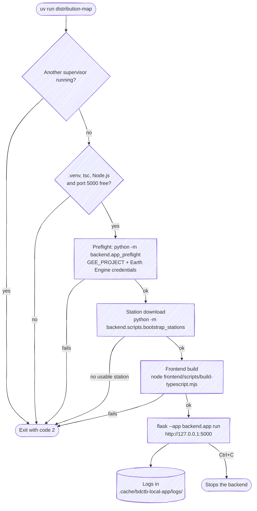
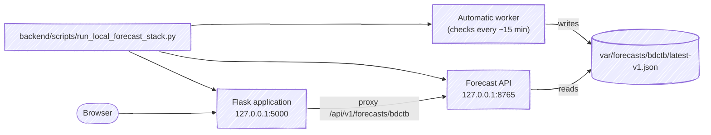
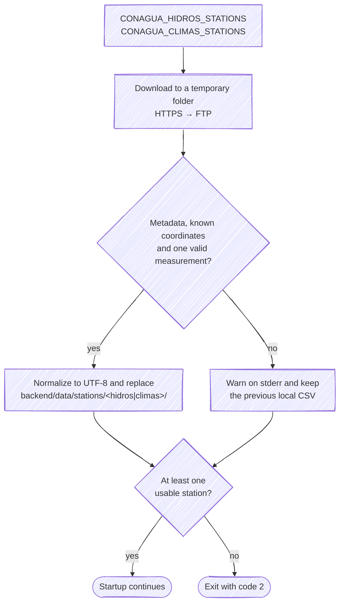
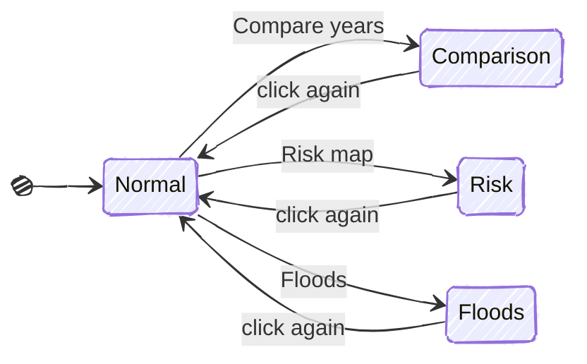
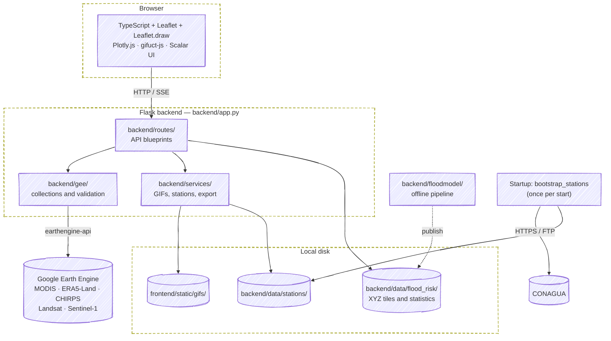
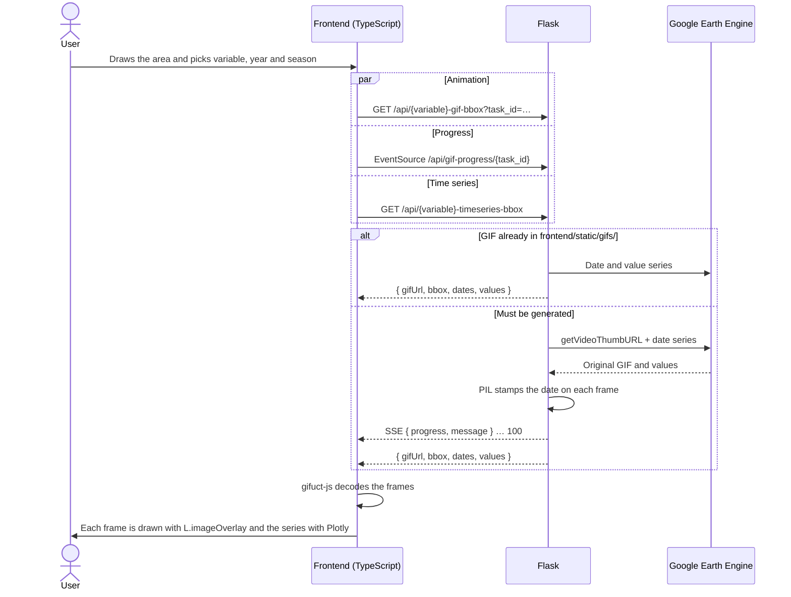
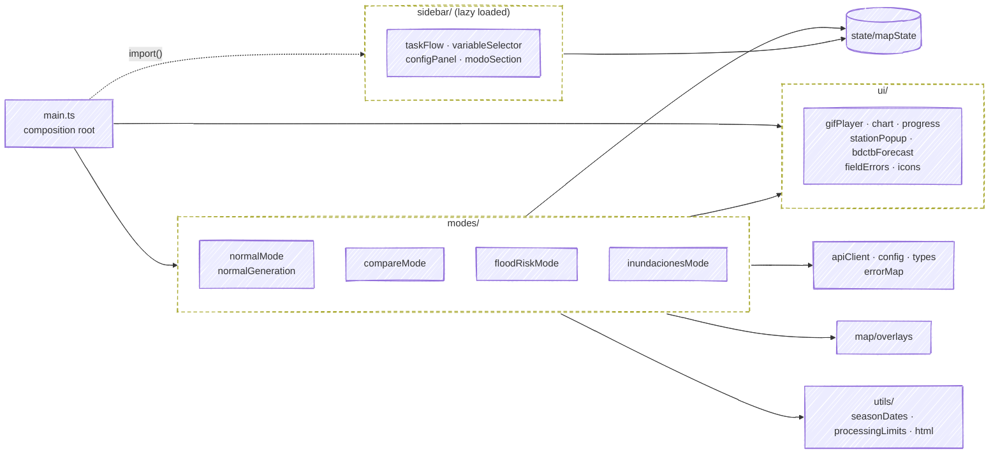

# Hydrometeorological Viewer — distributionMapApp

*Leer esto en [Español](README.md).*

Interactive web application to visualize animations and time series of hydrometeorological variables over the state of Tabasco, Mexico, using Google Earth Engine as the main satellite data source.

## Local quick start (app only)

First synchronize the app project and then run its public command from this
repository root:

```bash
uv sync
uv run distribution-map
```

`uv sync` installs the dependencies and registers the project command. The
public command is app-only: it compiles the TypeScript frontend through the
clean deterministic driver (`frontend/scripts/build-typescript.mjs`, also exposed as
`npm run build:ts`), which compiles TypeScript and copies the authored
`frontend/src/styles/styles.css` to its unchanged public `/static/styles.css` URL, validates the application dependency boundary, and serves
Flask in the foreground at `http://127.0.0.1:5000`. It never requires the
sibling model repository and never starts the Forecast API or the automatic
worker.

Prepare these prerequisites first:

- This app's existing `.venv/` and `node_modules/`, plus a Node.js runtime;
  the launcher performs no installation.
- `GEE_PROJECT` and one existing local Earth Engine authorization source:
  persistent Earth Engine credentials (normally
  `~/.config/earthengine/credentials`), a credential file selected by
  `GOOGLE_APPLICATION_CREDENTIALS`, or gcloud Application Default Credentials
  (normally `~/.config/gcloud/application_default_credentials.json`).

Startup follows these steps; any failure exits with code 2 and a safe message, without
leaving half-started processes behind:



The command first validates these prerequisites, performs an initial download
of the CONAGUA stations configured in `CONAGUA_HIDROS_STATIONS` and
`CONAGUA_CLIMAS_STATIONS`, compiles the frontend, and then serves the app in the
foreground. No separate station download command is needed. Downloads finish
before Flask loads its catalog; the periodic scraper scheduler is not started.
Responses are downloaded into a temporary directory. Latin-1 CSVs and reversible
UTF-8-as-Latin-1 decoding errors are normalized to UTF-8 before validation,
without altering observations. Valid accented text is preserved. Downloads only replace local CSVs
if they contain metadata for a station with known coordinates and at least one
valid date and measurement. If any download fails, the command warns and uses
available usable local data. If no usable station remains, it exits with code 2
without starting Flask. Data stays in the Git-ignored `backend/data/stations/` directory;
startup may take longer while CONAGUA responds or the downloader tries FTP.
Startup prints downloader progress and per-station rejection reasons to stderr,
including missing files, invalid metadata, unrecognized measurement columns
(check CSV encoding), and malformed rows. These messages distinguish download
failures from validation rejection; the final summary remains on stdout.
Press `Ctrl+C` to stop the
backend; diagnostic logs remain under `.cache/bdctb-local-app/logs/` with the
same private scheme as the general supervisor (`0600` per file, `0700` for the
directory, three files of at most 1 MiB each).

Without the model stack there is no valid forecast cache: the application keeps
working, but its forecast routes must not be presented as operational
prediction.

## Deferred path: local stack with automatic forecasting (compatibility)

The full stack with model, Forecast API, and worker remains preserved in
`backend/scripts/run_local_forecast_stack.py` for deferred use; it is no longer the
target of the public command:

```bash
.venv/bin/python backend/scripts/run_local_forecast_stack.py
.venv/bin/python backend/scripts/run_local_forecast_stack.py --model-repo /path/to/repository
```



The model is an explicit local dependency that remains in a separate
repository. By default, the script expects the sibling checkout at
`../distributionMapApp-model-research`; it never downloads the model
automatically.

The model repository selects its canonical paths through
`configs/model/bdctb_runtime_paths_v1.json`. That descriptor currently resolves
the calibrated bundle at
`runs/bdctb-exogenous-qgb-real-v1-calibrated-20260730`. The supervisor also
discovers the versioned GEFS weights there; it does not modify credentials or
install model dependencies.

For a nonstandard layout, `BDCTB_MODEL_BUNDLE` and `BDCTB_GEFS_WEIGHTS` remain
optional explicit overrides. `BDCTB_MODEL_CONFIG`, `BDCTB_STATE_ROOT`, and
`BDCTB_CACHE_PATH` may also be overridden. Export overrides in the launcher
process; this app's `.env` is not a launcher configuration source.

Prepare these prerequisites first:

- This app's existing `.venv/` and `node_modules/`; the supervisor performs no
  installation.
- The model repository's existing `.venv/` with model, GEFS, and GloFAS
  dependencies.
- `GEE_PROJECT` and one existing local Earth Engine authorization source:
  persistent Earth Engine credentials (normally
  `~/.config/earthengine/credentials`), a credential file selected by
  `GOOGLE_APPLICATION_CREDENTIALS`, or gcloud Application Default Credentials
  (normally `~/.config/gcloud/application_default_credentials.json`).
- One external GloFAS/EWDS credential configuration: `CDSAPI_RC` pointing to a
  credentials file (or the default `~/.cdsapirc`), or both `CDSAPI_URL` and
  `CDSAPI_KEY` in the launcher environment.

The script first validates these prerequisites and compiles the current
TypeScript application directly with the local TypeScript compiler
(`node_modules/.bin/tsc`). It then starts
three foreground processes: the app at
`http://127.0.0.1:5000`, the Forecast API at
`http://127.0.0.1:8765`, and the independent automatic worker. It configures
the app proxy to that API internally. Press `Ctrl+C` to stop only those three
children; diagnostic logs remain under `.cache/bdctb-local-stack/logs/`.
Each child retains at most three private `0600` log files of at most 1 MiB each;
the log directory is private (`0700`) and the current file retains the latest
diagnostic tail.

After `Ctrl+C`, optional cleanup is limited to supervisor diagnostics:

```bash
rm -rf .cache/bdctb-local-stack
```

Do **not** include the model's `var/operational/bdctb/` state or
`var/forecasts/bdctb/latest-v1.json` cache in routine cleanup. The state protects
submission recovery and the cache serves the last valid forecast; deleting
either intentionally resets those guarantees and can restore HTTP 503.

The browser and proxy only read the cache; they never execute the worker. The
worker ordinarily checks readiness every 15 minutes and retains its bounded
common-00Z issue, stable-GEFS, exact GloFAS-cost-at-or-below-6, and single-
submission-without-automatic-resubmission policies. On first start, HTTP 503 is
normal until a valid cache exists. If startup fails early, verify paths,
environments, Earth Engine authorization, provider credentials, and loopback
ports 5000/8765. Secret values are never printed.

Systemd, host users, provisioning, and installation are explicitly out of
scope for this local workflow.

---

## Overview

The state of Tabasco presents high hydrological and climatic variability, which generates the need for tools to explore and compare environmental data visually without requiring programming knowledge. This application solves that problem by offering a cartographic viewer in the browser from which anyone can:

- Select a region of interest by drawing a box on the map.
- Choose a hydrometeorological variable, a year, and a season.
- Automatically generate a satellite animation (GIF) and its associated time-series plot.
- Compare two different periods in parallel using the **comparison mode**.
- Visualize the flood risk map by municipality.
- Query the hydrometric levels of local stations: San Pedro (SPTTB) and Boca del Cerro (BDCTB).

**Default study area:** state of Tabasco (approximate center: 17.84° N, 92.62° W, initial zoom 8).

---

## Key Features

### Satellite Variables (Google Earth Engine)

| Variable | GEE Source | Temporal Resolution | Available Period |
|---|---|---|---|
| NDVI (vegetation) | MODIS MOD13Q1 | Every 16 days | 2000–2024 |
| 2 m Air Temperature | ERA5-Land (ECMWF) | Daily | 2000–2024 |
| Soil Moisture (0–7 cm) | ERA5-Land (ECMWF) | Daily | 2000–2024 |
| Daily Precipitation | CHIRPS (UCSB) | Daily | 2000–2024 |

Each variable generates:
- An **animated GIF** overlaid on the map, with the date shown on each frame.
- A **time-series plot** (spatial mean in the selected region) built with Plotly.

Surface water detection is not an animated variable: it runs in **flood detection mode**
with Sentinel-1 (radar, 2015–2024) or Landsat (optical, 2000–2024).

### Flood Risk Map

- Flood susceptibility for all of Tabasco (17 municipalities) at 30 m, in 5 state-relative classes (area quintiles), with a colour-blind safe YlGnBu palette.
- The index is the equal-weight rank average of a gradient boosting model trained on CENAPRED floods (2011, 2020), a model trained on Sentinel-1 seasonal flooding (2015–2025) and JRC 100-year flood depth. Terrain: hydrologically conditioned INEGI 5 m LiDAR (HAND, slope, TWI).
- Validated on floods the model never saw: on the 2011 flood it beats JRC depth (ROC 0.778 vs 0.766), and on the 2023–2025 Sentinel-1 seasons it beats both JRC and the official IPCET-PNUD 2022 map (ROC ~0.72 vs ~0.61). On 2011 IPCET scores higher (0.892), probably because it was calibrated on that event. Details in `backend/data/flood_risk/metadata.json` and in the [technical report, in Spanish](odd/reports/flood-susceptibility-model.md) ([PDF](odd/reports/flood-susceptibility-model/informe.pdf)).
- Served as static XYZ tiles: the app does no processing at startup or on click.

### Local Hydrological Stations

- **San Pedro — SPTTB** (lat 17.79°, lon −91.16°): station on the San Pedro river, Balancán.
- **Boca del Cerro — BDCTB** (lat 17.43°, lon −91.48°): station on the Usumacinta river, Tenosique.
- Data is downloaded from CONAGUA when the application starts and read from the local CSV files in `backend/data/stations/`. Temporal interpolation is applied for gaps of up to 7 days.
- Station markers appear on the map when no animation is active; clicking on them allows loading their complete series (2000–2024).

### CONAGUA station download

Every `uv run distribution-map` downloads the configured stations once before serving
the application (`backend/scripts/bootstrap_stations.py`):

- **HTTPS first, FTP as fallback**: it requests
  `https://sih.conagua.gob.mx/basedatos/<Hidros|Climas>/<STATION>.csv` and, if that fails,
  the CONAGUA FTP server.
- **Validation before replacement**: a new CSV only replaces the local one when it has
  metadata for a station with known coordinates and at least one date with a valid
  measurement.
- **Atomic writes**: downloads are staged in a temporary folder and moved with
  `os.replace`, so an interrupted connection never leaves a half-written CSV.



`backend/scrapers/runner.py` also contains an optional APScheduler scheduler (CONAGUA
Hidros on Mondays at 02:00, Climas at 02:30 and an SMN stub every hour). The launcher
does **not** start it; to keep stations fresh while the application runs, start it
separately with `uv run python -m backend.scrapers.runner`.

### Safe browser text rendering

Station names, municipality labels, station IDs and inundation legend values are rendered as data, never interpreted as server-supplied HTML. Both map panels share the station popup renderer; icons and forecast actions retain their existing behavior.

### Data Export

To facilitate offline analysis, the system offers:
- **Analysis ZIP**: Exports a ZIP package containing the active time series data in CSV format, along with the animation GIFs and analysis metadata.
  GIF paths must stay within `frontend/static/gifs/` and end in `.gif`; `gifs/name.gif` and `/static/gifs/name.gif` are accepted. Traversal, absolute paths, other files and escaping symlinks return HTTP 400; a missing permitted GIF returns HTTP 404.

### Operation Modes

**Normal Mode** (single map):
- Select variable, year, and season in the sidebar.
- Animation generation with a real-time progress bar.
- Time-series chart below the map, combinable with local station data.

**Comparison Mode** (two synchronized maps):
- Panel A and Panel B with independent selection of variable, year, and season.
- Synchronized playback of both GIFs: pause, step-by-frame, speed control.
- Independent Plotly charts per panel.
- Load local station data per panel via checkboxes.

**Flood Risk Mode**:
- Shows statewide susceptibility with a legend and a readout of the class under the cursor.
- Animation controls are locked to prevent overlay conflicts.
- Several municipalities can be checked at once to show their outline and stats card; the **Por municipio** view shows the choropleth.

**Flood Detection Mode**:
- Detects surface water inside the drawn area (max 4°×4°) for any date range.
- Satellite choice: Sentinel-1 (radar, 10 m, 2015–2024) or Landsat (optical, 30 m, 2000–2024).
- Automatic threshold (dynamic percentile) or manual (default −18.0).
- Shows the flood layer over a satellite background, a legend with opacity control and the flooded area in hectares.

Special modes are mutually exclusive: clicking the active mode again returns to normal
mode, and clicking another special mode switches to it directly (the previous one is
turned off).



### Other Technical Features

- Spatial selection using a rectangle drawn on the map (max. 8°×8°; 4°×4° for flood detection).
- Seasons: Winter (Dec–Feb), Spring (Mar–May), Summer (Jun–Aug), Autumn (Sep–Nov), Full Year.
- Maximum range per request: 10 years.
- GIF disk cache: GIFs older than 60 minutes are deleted by a cleanup that runs every 10 minutes.
- Collapsible sidebar to maximize map area.

---

## Technical Architecture



**Typical animation request flow:**



The cached GIF name combines variable, dates and a bbox hash: repeating the same query
reuses the GIF on disk without regenerating it, although the time series is queried
from Earth Engine again.

Generation progress uses **Server-Sent Events (SSE)** at `/api/gif-progress/<task_id>`. The registry is **process-local**: use one application process with concurrent request threads so generation and SSE reach the same registry.

| Setting | Default | Behavior |
| --- | --- | --- |
| `SSE_TASK_QUEUE_TIMEOUT_S` | 60 seconds | Wait between keep-alive comments. |
| `SSE_PROGRESS_RETENTION_S` | 3600 seconds, minimum 1 | Completed/error progress expires from producer completion; running tasks do not expire. |
| `SSE_MAX_PROGRESS_TASKS` | 1024, minimum 1 | Evict completed registrations first, then the oldest if all are running. |
| `SSE_MAX_PROGRESS_MESSAGES` | 128, minimum 2 | Discard oldest buffered progress without blocking generation; retain the latest terminal pair. |

- Closing a stream cleans its queue on completion, error, or client disconnect. An old producer or stream never removes a newer registration with the same ID.
- Expiry is checked on registry access and on cleanup daemon ticks (`GIF_CLEANUP_INTERVAL_S`). An evicted/expired ID emits the existing missing-task SSE event; already attached streams retain their own queue.
- Multiple processes or replicas require a shared progress backend; none is configured by this application. A load balancer alone does not make the registry shared.

### Frontend Architecture

The TypeScript code in `frontend/src/ts/` is organized by responsibility. `main.ts`
composes everything; sidebar modules are loaded lazily:



| Module | Responsibility |
|---|---|
| `main.ts` | Initializes Leaflet and wires modes and controls; holds no business logic. |
| `apiClient.ts`, `config.ts`, `types.ts`, `errorMap.ts` | Typed backend requests, endpoints, API types and error translation. |
| `state/mapState.ts` | Session state: bbox, active mode, variable, series and animation players. |
| `modes/` | Behavior of each mode: normal, comparison, risk and floods. |
| `sidebar/` | Sidebar step flow, variable selector, configuration and mode selection. |
| `ui/` | GIF player, Plotly charts, progress, station popups and BDCTB forecast. |
| `map/overlays.ts` | Leaflet overlay layers. |
| `utils/` | Season dates (UTC), processing limits and text escaping. |

**Generation and animation lifecycle:**

- **`mapState.ts`** holds session state: selected bbox, active mode, loaded time series, and references to animation players (`GifPlayer`, `SyncPlayer`, `SoloPlayer`). `GifPlayer` owns its frame blob URLs: reloading releases replaced frames, disposing invalidates pending loads, and a failed or superseded load releases its candidate frames without replacing the current animation.
- **`normalMode.ts`** gives each generation its own lifecycle: obsolete responses, decode completions and SSE callbacks cannot replace or clear newer state. Clearing/reinitializing the mode invalidates pending generations; the existing animation stays owned until a current replacement has decoded successfully. Frame seasons and years use the API's UTC calendar dates, independently of the browser's timezone. `normalGeneration.ts` uses the same captured ownership check for error feedback and the payload-free `generationComplete` event, so obsolete completions cannot unlock a newer request, including clear/mode changes between promise resolution and its continuation.
- **`compareMode.ts`** owns generations per panel, so A and B can finish independently. Shared progress belongs to the latest pending request; clearing a panel or leaving/reinitializing comparison invalidates obsolete work. Failed/stale decoded candidates are disposed without replacing owned frames, and late B view-sync callbacks cannot restore cleared state.

---

## Prerequisites

| Component | Minimum Version Recommended |
|---|---|
| Python | 3.11 |
| Node.js | 18 |
| npm | 9 |
| uv | Latest — recommended Python package manager |

**Google Earth Engine Account:**
- You need an approved GEE account and a Google Cloud project with the Earth Engine API enabled.
- More information: [earthengine.google.com](https://earthengine.google.com/)

**Python Dependencies** (see `pyproject.toml`):
- Managed and synchronized automatically using `uv`.

**Node Dependencies** (see `package.json`):

| Type | Packages |
|---|---|
| Runtime | `leaflet`, `gifuct-js`, `lucide` |
| Development | `typescript`, `@types/leaflet`, `@types/node`, `vitest`, `@vitest/browser`, `jsdom`, `jszip`, `@playwright/test`, `playwright`, `eslint`, `@eslint/js`, `typescript-eslint`, `prettier` |

In the browser, Leaflet, Leaflet.draw, Plotly, gifuct-js and JSZip load from CDNs
(`frontend/templates/index.html`).

---

## Installation and Configuration

### 1. Clone the repository

```bash
git clone https://github.com/ElGuill3/distributionMapApp.git
cd distributionMapApp
```

---

### 2. Configure Virtual Environment and Python Dependencies

We recommend using **[uv](https://github.com/astral-sh/uv)** to manage your virtual environment and dependencies quickly.

```bash
# Sync dependencies and create the virtual environment automatically
uv sync
```

This will create a virtual environment in the `.venv/` folder at the root of the project and install all project and development dependencies.

To activate the virtual environment in your terminal:

```bash
# Linux / macOS:
source .venv/bin/activate
# Windows (PowerShell):
.venv\Scripts\Activate
# Windows (CMD):
.venv\Scripts\activate.bat
```

Or you can run any command directly using `uv run`:
```bash
uv run python -m backend.app
```

---

### 3. Configure Environment Variables

Copy the `.env.example` file to `.env` in the root of the project and configure the variables:

```bash
cp .env.example .env
```

> [!IMPORTANT]
> You must configure `GEE_PROJECT` with the real ID of your Google Cloud project. To see the list of your projects and find the correct ID, you can run:
> ```bash
> gcloud projects list
> ```

| Environment Variable | Default Value | Description |
|---|---|---|
| `GEE_PROJECT` | `inundaciones-proyecto` | Google Cloud project ID with the Earth Engine API enabled. |
| `FLASK_DEBUG` | `false` | Enables Flask debug mode if set to `true`. |
| `CONAGUA_HIDROS_STATIONS` | `BDCTB,SPTTB` | Keys of hydrometric stations to download (comma-separated). |
| `CONAGUA_CLIMAS_STATIONS` | `BDCTB,SPTTB` | Keys of climatological stations to download (comma-separated). |
| `MAX_SPAN_DEG` | `8.0` | Maximum spatial span allowed in degrees for GEE requests. |
| `MAX_YEARS_RANGE` | `10.0` | Maximum date range allowed in years for GEE requests. |
| `MAX_SPAN_DEG_S2` | `4.0` | Maximum span in degrees for flood detection (Sentinel-1 and Landsat). |
| `MAX_TOTAL_PIXELS` | `26000000` | Maximum pixel limit for GEE processing. |
| `BASE_PIXELS_PER_FRAME` | `589824` | Base pixel size per animation frame (768x768). |
| `BASE_PIXELS_S2` | `262144` | Base pixel size per frame for Sentinel-2 (512x512). |
| `MIN_GIF_DIM` | `256` | Minimum allowed dimensions in pixels for the generated GIF. |
| `GIF_MAX_AGE_MINUTES` | `60` | Maximum age in minutes of cached GIFs before cleanup. |
| `GIF_CLEANUP_INTERVAL_S` | `600` | GIF cleanup thread interval in seconds (10 minutes). |
| `GEE_MODIS_NDVI` | `MODIS/061/MOD13Q1` | GEE NDVI dataset ID. |
| `GEE_ERA5_LAND_DAILY` | `ECMWF/ERA5_LAND/DAILY_AGGR` | GEE ERA5-Land temperature and soil moisture dataset ID. |
| `GEE_CHIRPS_DAILY` | `UCSB-CHG/CHIRPS/DAILY` | GEE CHIRPS precipitation dataset ID. |
| `GEE_S2_SR` | `COPERNICUS/S2_SR_HARMONIZED` | GEE Sentinel-2 SR Harmonized dataset ID. |
| `RATE_LIMIT_ENABLED` | `true` | Enables or disables rate limiting. |
| `RATE_LIMIT_GIF` | `30/minute` | Each GIF endpoint, per IP. |
| `RATE_LIMIT_TIMESERIES` | `60/minute` | Each timeseries endpoint, per IP. |
| `RATE_LIMIT_EXPORT` | `10/minute` | Export bundles, per IP. |
| `RATE_LIMIT_FLOOD` | `60/minute` | Flood maps/detection, independently per endpoint and IP. |
| `RATE_LIMIT_FLOOD_STATS` | `30/minute` | Flood statistics, per IP. |
| `RATE_LIMIT_STATION` | `60/minute` | Each station endpoint, per IP. |
| `RATE_LIMIT_FORECAST` | `60/minute` | Forecast proxy, per IP. |
| `GIF_DOWNLOAD_TIMEOUT_S` | `120` | Timeout in seconds to download the GIF from Earth Engine. |
| `SSE_TASK_QUEUE_TIMEOUT_S` | `60` | Seconds between SSE keep-alive comments. |
| `SSE_WAIT_ATTEMPTS` | `100` | Attempts (every 0.1 s) to find a task queue before answering "Tarea no encontrada". |
| `SSE_PROGRESS_RETENTION_S` | `3600` | Retention of finished progress (see the SSE table in Technical Architecture). |
| `SSE_MAX_PROGRESS_TASKS` | `1024` | Maximum registered progress tasks. |
| `SSE_MAX_PROGRESS_MESSAGES` | `128` | Maximum messages per task. |
| `BDCTB_FORECAST_API_BASE_URL` | `http://127.0.0.1:8765` | Local forecast API used by the `/api/v1/forecasts/bdctb` proxy. |
| `BASE_DIR_OVERRIDE` | *(unset)* | Alternative project root for data and static files (used by tests). |

Processing guards `MAX_SPAN_DEG`, `MAX_YEARS_RANGE` and `MAX_SPAN_DEG_S2` must be finite positive numbers (fractional values are supported). Empty, malformed, zero, negative, NaN or infinite values abort startup with `<ENV_KEY> must be a finite number greater than zero.` without echoing the value. Defaults remain 8°, 10 years and 4° respectively.

The HTML page embeds only these three numeric processing limits as JSON before loading the client modules. Map drawing uses the configured span while keeping the existing `MAX_SPAN_DEG` export; missing/malformed client context falls back to the declared defaults. Normal/comparison requests check the configured span and UTC year range before changing animation or progress ownership. Flood detection checks `MAX_SPAN_DEG_S2` for both satellites before clearing layers or disabling the button. Rejected requests retain the current view and send no HTTP/SSE request. Server validation remains authoritative; reload the page after changing server settings.

Rate quotas use Flask-Limiter notation (for example, `1/minute` or `10/minute;100/hour`). Every count must be positive. Invalid or empty values abort startup with `<ENV_KEY> must specify positive request rates.` without echoing the value, even when limiting is disabled. Quotas are independent per endpoint/IP, process-local, and count rejected HTTP requests too. Over quota returns the existing JSON HTTP 429 response with `Cache-Control: no-store`.

---

### 4. Authenticate Google Earth Engine

```bash
earthengine authenticate
```

Follow the on-screen instructions. Once authenticated, verify that it works:

```bash
python -c "import ee; ee.Initialize(); print('GEE OK')"
```

Make sure `.env` contains your correct Google Cloud project ID (`GEE_PROJECT`).

> **Don't have a GEE project?** Go to [console.cloud.google.com](https://console.cloud.google.com), create a project, enable the *Earth Engine API*, and copy the project ID.

---

### 5. Local Station Data

`uv run distribution-map` downloads the stations on startup, so you normally do not need
to copy anything. CSVs live in `backend/data/stations/hidros/` and
`backend/data/stations/climas/` (files directly in `backend/data/stations/` are also
accepted). Expected format:

```
<lines 1–6: metadata (automatically skipped)>
Fecha,Nivel(m),...
YYYY-MM-DD,value,...
```

`LOCAL_STATIONS` is built automatically from those CSVs. To add a station:

1. Add its key to `CONAGUA_HIDROS_STATIONS` or `CONAGUA_CLIMAS_STATIONS` in `.env`.
2. Register its coordinates in `STATION_COORDS` in `backend/config.py`; stations without
   known coordinates are rejected during download.

---

### 6. Flood Susceptibility Map

The repository already ships the published map in `backend/data/flood_risk/` (tiles, municipality statistics and metadata); you do not need to build it to run the app.

To rebuild it from public sources (downloads ~5 GB into `.cache/`, which is not versioned), install the pipeline dependency group and run the steps in order:

```bash
uv sync --group floodmodel
uv run python -m backend.floodmodel lidar-index && uv run python -m backend.floodmodel lidar-download
uv run python -m backend.floodmodel boundaries
uv run python -m backend.floodmodel terrain-mosaic --resolution 15 && uv run python -m backend.floodmodel cem
uv run python -m backend.floodmodel terrain-aux && uv run python -m backend.floodmodel terrain-condition
uv run python -m backend.floodmodel terrain-derivatives --resolution 15 --conditioned
uv run python -m backend.floodmodel inventory && uv run python -m backend.floodmodel gee-features
uv run python -m backend.floodmodel stack
uv run python -m backend.floodmodel labels && uv run python -m backend.floodmodel s1-seasons
uv run python -m backend.floodmodel validate && uv run python -m backend.floodmodel final
uv run python -m backend.floodmodel publish
```

Earth Engine steps need `GEE_PROJECT` and credentials (step 4). The 15 m hydrology uses ~8 GB of RAM.

---

### 7. Install Node Dependencies and Compile TypeScript

> [!IMPORTANT]
> Compiling the TypeScript code is **mandatory** before starting the application for the first time. If you do not run this step, the UI will display a blank page with 404 errors when trying to load `main.js`.

```bash
npm install
npm run build:ts
```

For development with automatic recompilation on file saves:

```bash
npm run watch:ts
```

---

### 8. Run Tests (Optional but Recommended)

```bash
# Unit and integration tests (Vitest)
npm test

# Unit tests in watch mode
npm run test:watch

# E2E tests: build first; Playwright starts the rendered frontend server
npm run build:ts
npm run test:e2e

# E2E tests in UI mode (for debugging)
npm run test:e2e:ui
```

---

## Basic Usage

### Start the Application

```bash
python -m backend.app
```

Open your browser and navigate to: **http://127.0.0.1:5000**

---

### Normal Mode — Animating a Variable

1. **Draw a rectangle** on the map to define the region of interest (max. ~8°×8°).
2. Expand the section of the desired variable in the sidebar (e.g. *NDVI*).
3. Select the **year** and **season**.
4. Click **"Generar animación"** (Generate animation).
5. A progress bar will appear while GEE processes the GIF (takes 15–60s depending on region size and date range).
6. The GIF will overlay on the map. Below it, the **time-series chart** showing the spatial mean for the selected region will render.
7. Use the **playback bar** at the bottom to play, pause, step frames, and adjust speed.
8. To reset and start over, click **"Limpiar"** (Clear) in the top toolbar.

---

### Comparison Mode — Two Periods Side-by-Side

1. Click **"Comparar años"** (Compare years) in the sidebar. Sidebar controls lock and two panels (A and B) appear with separate selectors.
2. In Panel A: choose variable, year, and season; click **"Generar panel A"**.
3. In Panel B: choose variable, year, and season; click **"Generar panel B"**.
4. Once both load, playback **synchronizes automatically**.
5. To overlay local station data on either panel, check the corresponding boxes under the selectors (data loads matching the panel's season).
6. To exit, click **"Comparar años"** again. The state resets completely.

---

### Flood Risk Mode

1. Click **"Mapa de riesgo"** (Risk Map) in the sidebar. Animation controls lock and the statewide susceptibility layer appears with its legend.
2. Hover the map: the bottom-left readout shows the class and municipality at that point.
3. Check a municipality to zoom to it and open its card (class shares, share of high or very high susceptibility and statewide rank).
4. Under **Vista** (View) choose **Por municipio** (By municipality) for a choropleth of the share of high or very high susceptibility.
5. Click **"Mapa de riesgo"** again to exit the mode.

---

### Flood Detection Mode

1. Draw a rectangle over the area to analyze and click **"Inundaciones"** (Floods) in the sidebar.
2. Pick the **satellite**: Sentinel-1 (radar, 2015–2024) or Landsat (optical, 2000–2024).
3. Set **Fecha Inicio** (start date) and **Fecha Fin** (end date).
4. Pick the **Modo de Umbral** (threshold mode): automatic (dynamic percentile) or manual with your own value.
5. Click **"Visualizar Inundación"**: the detected water layer and satellite background are added, and the legend shows the flooded area in hectares.
6. Click **"Inundaciones"** again to exit (its layers and legend are removed).

---

### Local Stations (Normal Mode)

In the **"Estaciones locales (nivel)"** section in the sidebar:
1. Choose **year** and **season**.
2. Click **"Cargar serie de nivel"** (Load level series).
3. The series will be added to the chart below the map alongside any active GEE variables.

You can also click a station marker on the map and choose **"Ver datos 2000–2024"** to load its full series.

---

## Project Structure

```
distributionMapApp/
│
├── pyproject.toml            # Python project dependencies and metadata (managed by uv)
├── uv.lock                   # Python dependency lockfile (managed by uv)
├── package.json              # Node dependencies and TS compile scripts
├── tsconfig.json             # TypeScript compiler settings
├── .env.example              # Environment variable template (.env lives at the root)
│                             # + tool configs: eslint, prettier, vitest, playwright, ruff
│
├── backend/                  # Flask application and server code
│   ├── app.py                    # Flask entry point: initializes GEE, registers blueprints
│   ├── config.py                 # Global constants: paths, GEE collections, limits, stations
│   ├── extensions.py             # Shared request limiter (Flask-Limiter)
│   ├── app_preflight.py          # Dependency and Earth Engine credential preflight
│   ├── openapi.yaml              # OpenAPI 3.1.0 REST API specification
│   ├── routes/                   # Flask Blueprints — REST API endpoints
│   │   ├── gif_routes.py         # GET /api/<var>-gif-bbox
│   │   ├── timeseries_routes.py  # GET /api/<var>-timeseries-bbox
│   │   ├── flood_routes.py       # GET /api/flood-risk/*, /api/flood-detection, /api/flood-stats
│   │   ├── station_routes.py     # GET /api/local-station-level-range
│   │   ├── progress_routes.py    # GET /api/gif-progress/<task_id> (SSE)
│   │   └── export_routes.py      # POST /api/export/bundle
│   ├── gee/                      # Google Earth Engine processing modules
│   │   ├── ndvi.py               # NDVI — MODIS MOD13Q1
│   │   ├── temperature.py        # Temperature — ERA5-Land (Kelvin → Celsius)
│   │   ├── soil.py               # Soil moisture — ERA5-Land
│   │   ├── precipitation.py      # Daily precipitation — CHIRPS
│   │   ├── water.py              # Flood detection — Sentinel-1 (VH) and Landsat (MNDWI)
│   │   ├── schemas.py            # Pydantic parameter validation schemas
│   │   └── utils.py              # Shared utils: bbox validation, seasons, GIF dimensions
│   ├── services/
│   │   ├── gif_service.py        # Downloads GEE GIFs, annotates with PIL, cache & cleanup
│   │   ├── station_service.py    # Reads and preprocesses local station CSVs
│   │   └── export_service.py     # Decoupled ZIP bundle exports (CSV + GIFs + metadata)
│   ├── floodmodel/               # Offline susceptibility map pipeline (`floodmodel` group)
│   │   ├── lidar.py, terrain.py  # INEGI LiDAR: download, mosaic, conditioning, HAND
│   │   ├── cenapred.py           # CENAPRED flood inventory and official maps
│   │   ├── gee_layers.py         # Earth Engine layers, Sentinel-1 seasons, GAUL boundaries
│   │   ├── model.py, pipeline.py # Labels, LightGBM, ensemble and held-out validation
│   │   └── publish.py            # Classes, XYZ tiles and municipality statistics
│   ├── scrapers/                 # Automatic scrapers for local data
│   │   ├── base.py               # Abstract Base Scraper class
│   │   ├── conagua.py            # FTP scraper for CONAGUA station data
│   │   ├── smn.py                # Stub scraper for SMN data
│   │   └── runner.py             # Scheduled runner daemon (APScheduler)
│   ├── scripts/                  # `distribution-map` launcher and maintenance utilities
│   │   ├── run_app.py            # `uv run distribution-map` command
│   │   ├── bootstrap_stations.py # Initial station download
│   │   ├── generate_schemas.py   # Pydantic schemas → openapi.yaml
│   │   ├── convert_lf.py         # Normalizes line endings to LF
│   │   └── quality/              # coverage.sh, lint.sh, format.sh
│   ├── data/
│   │   ├── flood_risk/           # Published map: tiles/{z}/{x}/{y}.png, municipalities.geojson, metadata.json
│   │   └── stations/             # Local level series (downloaded by scrapers)
│   └── tests/                    # Python tests and isolated fixtures (pytest)
│
└── frontend/                        # Browser interface
    ├── templates/
    │   ├── index.html               # Main HTML layout template
    │   └── scalar.html              # Interactive API docs (Scalar UI template)
    ├── static/                      # Files served under /static/
    │   ├── vendor/ and assets/      # Third-party libraries and versioned images
    │   ├── main.js                  # Compiled JavaScript from TypeScript (generated)
    │   ├── styles.css               # Published copy of src/styles/styles.css (generated)
    │   └── gifs/                    # Generated GIFs (temp cache, automatically cleaned)
    ├── scripts/build-typescript.mjs # Clean TypeScript build (`npm run build:ts`)
    ├── src/
    │   ├── styles/styles.css        # Authored styles published to static/ by build:ts
    │   └── ts/                      # TypeScript compiled to static/
    │       ├── main.ts              # Composition root and initialization
    │       ├── apiClient.ts         # Typed HTTP client
    │       ├── config.ts            # URLs, seasons and UI configuration
    │       ├── state/               # Shared map state
    │       ├── modes/               # Normal, comparison and flood modes
    │       ├── sidebar/             # Sidebar controls
    │       ├── map/                 # Leaflet overlays
    │       ├── ui/                  # GIFs, charts and progress
    │       └── utils/               # Dates, limits and text escaping
    └── tests/
        ├── unit/                    # Source-only Vitest tests (no prior build)
        └── e2e/                     # Playwright and provider-free test server
```

---

## API Endpoints

| Endpoint | Method | Key Parameters | Response |
|---|---|---|---|
| `/api/ndvi-gif-bbox` | `GET` | `start`, `end` or `year` + `season`, `bbox`, `ratio`, `task_id` | `{ gifUrl, bbox, dates, ndvi[] }` |
| `/api/era5-temp-gif-bbox` | `GET` | same | `{ gifUrl, bbox, dates, temp[] }` |
| `/api/era5-soil-gif-bbox` | `GET` | same | `{ gifUrl, bbox, dates, soil_pct[] }` |
| `/api/imerg-precip-gif-bbox` | `GET` | same | `{ gifUrl, bbox, dates, precip_mm[] }` |
| `/api/{ndvi,era5-temp,era5-soil,imerg-precip}-timeseries-bbox` | `GET` | `start`, `end` or `year` + `season`, `bbox` | `{ dates, bbox, <values>[] }` |
| `/api/gif-progress/<task_id>` | `GET` | — | SSE: `{ progress: 0–100 or -1, message }` |
| `/api/flood-risk/metadata` | `GET` | — | `{ classes, tiles, bounds, sources, validation }` |
| `/api/flood-risk/municipalities` | `GET` | — | GeoJSON with `class_share`, `high_share`, `mean_score`, `rank` |
| `/api/flood-risk/tiles/{z}/{x}/{y}.png` | `GET` | — | PNG tile (z 7–12) |
| `/api/flood-detection` | `GET` | `start`, `end`, `bbox`, `satellite` (`sentinel1`/`landsat`), `auto`, `threshold` | `{ satellite, computed_threshold, background_layer, water_layer, … }` |
| `/api/flood-stats` | `GET` | same as `/api/flood-detection` | `{ total_ha }` |
| `/api/local-stations` | `GET` | — | Catalog `{ <id>: { name, type, coords, station_name, municipio } }` |
| `/api/local-station-level-range` | `GET` | `station`, `start`, `end` | `{ station, type, dates, value[], unit, level_m[], precip_mm[] }` |
| `/api/v1/forecasts/bdctb` | `GET` | — | Proxy to the local forecast API (`503` until a valid cache exists) |
| `/api/export/bundle` | `POST` | `gifPaths`, `seriesData`, `bbox`, `metadata` | ZIP archive (CSV + GIFs + metadata) |
| `/api/docs` | `GET` | — | Interactive documentation (Scalar UI) |
| `/api/docs/openapi.yaml` | `GET` | — | OpenAPI 3.1.0 specification in YAML |

**Common parameters:**
- `start` / `end`: dates in `YYYY-MM-DD` format. All GIF and timeseries routes, including NDVI, also accept `year` + `season`; a complete explicit date pair takes precedence, otherwise seasonal shorthand replaces the pair.
- `bbox`: JSON array `[minLon, minLat, maxLon, maxLat]` in decimal degrees (WGS-84). Requires `minLon < maxLon`, `minLat < maxLat`, lon within `[-180, 180]`, lat within `[-90, 90]` and finite values; anything else is rejected with 400.
- `ratio`: GIF width/height ratio; must be a positive finite number.
- `task_id`: unique task identifier for the SSE progress channel.
- `muni`: municipality key (e.g. `centla`, `macuspana`, `tenosique`).
- `station`: station identifier with a type suffix (`BDCTB_hidro`, `BDCTB_clima`, `SPTTB_hidro`, `SPTTB_clima`); `/api/local-stations` returns the full catalog.

---

## Development Notes

### Recompiling TypeScript

After modifying any file in `frontend/src/ts/`, compile them using:

```bash
npm run build:ts
```

For watch mode (recompiles automatically on change):

```bash
npm run watch:ts
```

### Testing Stack

**Vitest** — unit and integration tests:
Tests import authored TypeScript directly and run without generated `frontend/static/` JavaScript. Build output is still required to serve the application.
```bash
npm test              # runs all tests
npm run test:watch    # watch mode
```

**Playwright** — End-to-End browser tests:
```bash
npm run build:ts
npm run test:e2e
# Or in UI mode:
npm run test:e2e:ui
```

The runner starts `frontend/tests/e2e/server.py --port 8080` on loopback with real Jinja rendering and validated runtime limits, without application providers. API calls return HTTP 503 unless mocked by the browser test. CDN dependencies still require network access. An existing server is never silently reused.

Use `PLAYWRIGHT_EXECUTABLE_PATH=/absolute/path/to/chromium npm run test:e2e` for an already provisioned compatible portable browser, or the default Playwright Chromium installation. For an explicitly selected running server, use `BASE_URL=http://127.0.0.1:5000 SKIP_WEB_SERVER=1 npm run test:e2e`; this opts out of the synthetic API boundary.

The action checks exercise the public generation event, actual modal close/Escape, and Leaflet drawing plus the Generate button against a synthetic provider failure. They assert dates/bbox, recovery, and export remaining disabled. CSS-only toolbar checks are not end-to-end export proof; real provider processing and ZIP/PNG downloads remain outside this browser suite.

### Quality Tools

**Python** — Coverage, linting, and formatting checks using `pytest-cov` and `ruff`.

```bash
uv run backend/scripts/quality/coverage.sh
uv run backend/scripts/quality/lint.sh
uv run backend/scripts/quality/format.sh
```

**TypeScript and CSS** — Linting and formatting checks using ESLint and Prettier.

```bash
npm run lint:ts      # ESLint over frontend/src/ts and frontend/tests
npm run format:ts    # Prettier check over the TypeScript and authored CSS
npm run quality:ts   # Lint + format check
```

### Google Earth Engine API Limits

- **Maximum date span per request:** 10 years.
- **Maximum bounding box span:** 8°×8° for animations and 4°×4° for flood detection.
- **Maximum total pixels:** 26,000,000.
- Responses from GEE take 15s to several minutes depending on parameters.

### GIF Cache

GIFs are cached under `frontend/static/gifs/` as `<variable>_<start>_<end>_<bbox-hash>.gif`. A cleanup thread runs every `GIF_CLEANUP_INTERVAL_S` seconds (10 minutes) and deletes those older than `GIF_MAX_AGE_MINUTES` (60 minutes). Both values are set in `.env`.

### Runtime Lifecycle

The application is meant to run locally with `uv run distribution-map`; no server, proxy
or deployment configuration is included.

Importing `backend.app` constructs Flask routes without starting Earth Engine, creating runtime directories or launching GIF cleanup. `uv run distribution-map` and `python -m backend.app` initialize before serving (the latter listens on `0.0.0.0:5000`); a WSGI server loading `backend.app:app` initializes on its first request. `initialize_runtime()` is process-local and thread-safe: repeated calls do not start duplicate cleanup threads, and EE failure prevents cleanup startup. Dependency preflight never initializes runtime.

Synthetic tests set `app.config["INITIALIZE_RUNTIME"] = False` to disable request-triggered startup. Explicit initializer calls still require mocked providers and isolated files.

The SSE progress registry is process-local: any way of serving the application must use
**a single process** with several threads, or a generation's progress will not reach the
client.

---

## Design Decisions

The frontend architecture was structured following a **Spec-Driven Development (SDD)** process. The initial `main.ts` was split into modules with decoupled responsibilities:

- **`main.ts`** acts as a *composition root*, wiring up infrastructure and routing actions to mode handlers.
- **`apiClient.ts`** centralizes all HTTP and SSE requests with strict return types and error mappings.
- **`state/mapState.ts`** serves as a typed central state store with read/write accessors.
- **`modes/`** holds the logic for each mode (`normalMode`, `compareMode`, `floodRiskMode`, `inundacionesMode`); adding a mode means creating its module and registering it in `main.ts` and `sidebar/modoSection.ts`.

---

## Future Scope

- Export single series to CSV without packaging them in the analysis ZIP.
- Keep stations updated automatically while the application runs (today the `backend/scrapers/runner.py` scheduler is started manually).
- Support for irregular polygon geometries (in addition to boxes).
- Integration of additional local hydrological stations.

---

## Credits and Sources

| Source | Description |
|---|---|
| [MODIS MOD13Q1](https://developers.google.com/earth-engine/datasets/catalog/MODIS_061_MOD13Q1) | NDVI, 250 m, every 16 days |
| [ERA5-Land Daily](https://developers.google.com/earth-engine/datasets/catalog/ECMWF_ERA5_LAND_DAILY_AGGR) | Temp & soil moisture, ~9 km |
| [CHIRPS Daily](https://developers.google.com/earth-engine/datasets/catalog/UCSB-CHG_CHIRPS_DAILY) | Daily precipitation, ~5.5 km |
| [Sentinel-1 GRD](https://developers.google.com/earth-engine/datasets/catalog/COPERNICUS_S1_GRD) | Radar flood detection (VH), 10 m; 2015–2025 seasonal flooding for the susceptibility map |
| [INEGI, 5 m LiDAR DEM](https://www.inegi.org.mx/temas/relieve/continental/) | Susceptibility map terrain (2007 flight, 2012 edition) |
| [INEGI, Continuo de Elevaciones Mexicano 3.0](https://www.inegi.org.mx/app/geo2/elevacionesmex/) | 15 m fill for LiDAR gaps |
| [CENAPRED, Atlas Nacional de Riesgos](http://www.atlasnacionalderiesgos.gob.mx/) | Observed 2011 and 2020 floods; PNUD 2018 and IPCET-PNUD 2022 maps used for comparison only |
| [JRC/CEMS GloFAS Flood Hazard v2.1](https://developers.google.com/earth-engine/datasets/catalog/JRC_CEMS_GLOFAS_FloodHazard_v2_1) | Flood depth by return period |
| [MERIT Hydro](https://developers.google.com/earth-engine/datasets/catalog/MERIT_Hydro_v1_0_1) | Upstream area and LiDAR gap filling |
| [JRC Global Surface Water](https://developers.google.com/earth-engine/datasets/catalog/JRC_GSW1_4_GlobalSurfaceWater) | Permanent water |
| [ESA WorldCover](https://developers.google.com/earth-engine/datasets/catalog/ESA_WorldCover_v200) | Land cover |
| [FAO GAUL 2025](https://developers.google.com/earth-engine/datasets/catalog/FAO_GAUL_2025_level2) | Municipal boundaries |
| [Landsat 5/7/8/9 Collection 2 L2](https://developers.google.com/earth-engine/datasets/catalog/landsat) | Optical flood detection (MNDWI), 30 m |
| [CONAGUA / IMTA](https://www.gob.mx/conagua) | Local hydrometric and meteorological station data |
| [Google Earth Engine](https://earthengine.google.com/) | Cloud geospatial processing engine |

The verified audit scope, hypothesis dispositions and operational boundaries are recorded in [the evidence report](odd/reports/audit-hardening-evidence.md).
