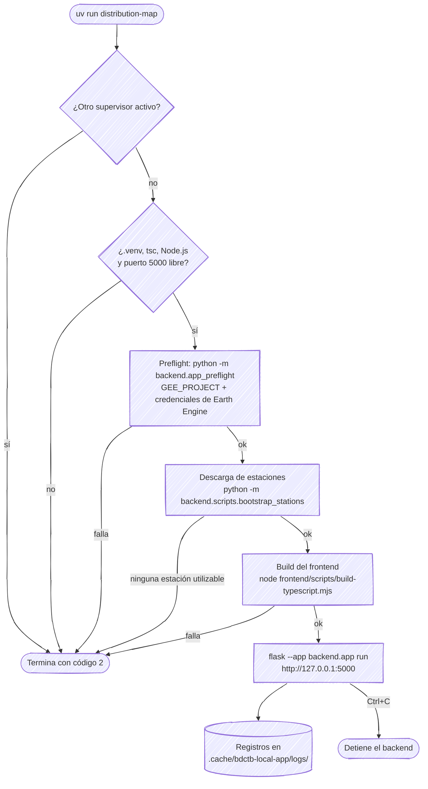
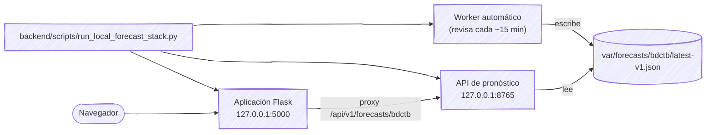
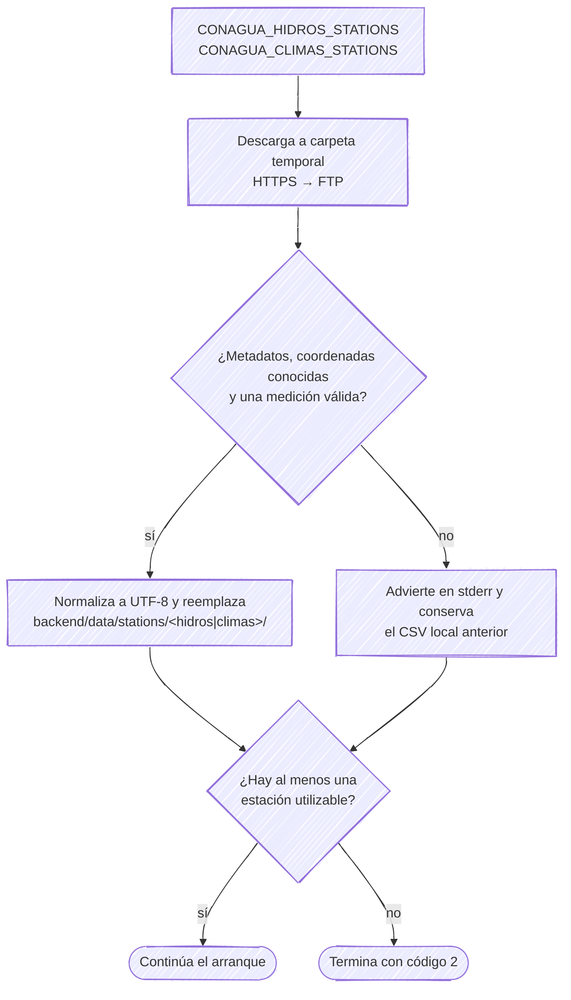
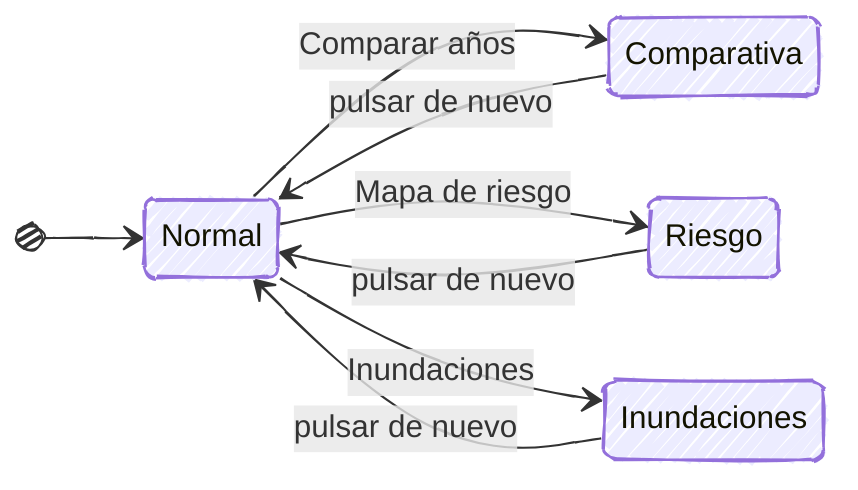
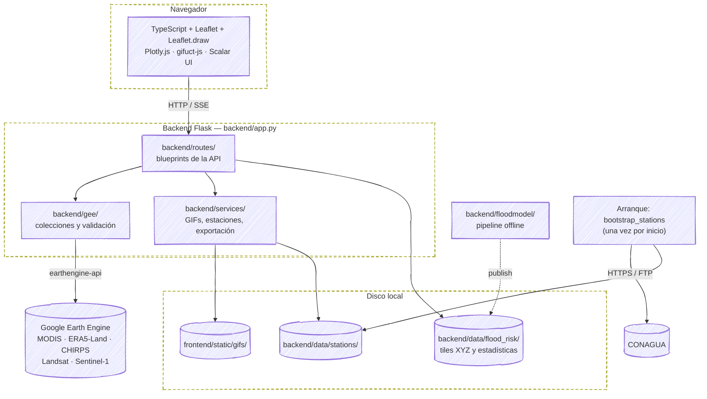
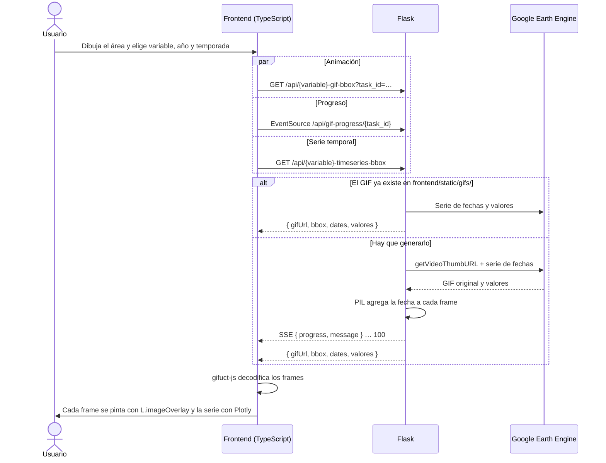
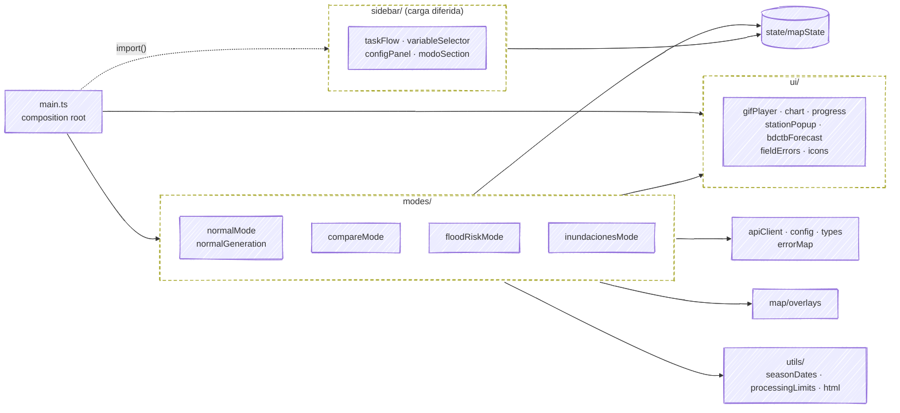

# Visor Hidrometeorológico — distributionMapApp

*Read this in [English](README.en.md).*

Aplicación web interactiva para visualizar animaciones y series temporales de variables hidrometeorológicas sobre el estado de Tabasco, México, usando Google Earth Engine como principal fuente de datos satelitales.

## Inicio rápido local (solo aplicación)

Sincronice primero el proyecto de la aplicación y, desde la raíz de este
repositorio, ejecute el comando público:

```bash
uv sync
uv run distribution-map
```

`uv sync` instala las dependencias y registra el comando del proyecto. El
comando público es solo-aplicación: compila el frontend TypeScript con el
driver limpio determinista (`frontend/scripts/build-typescript.mjs`, expuesto también
como `npm run build:ts`), que compila TypeScript y copia el CSS fuente
`frontend/src/styles/styles.css` a la misma URL pública `/static/styles.css`, valida el límite de dependencias de la aplicación y
sirve Flask en primer plano en `http://127.0.0.1:5000`. Nunca requiere el
repositorio hermano del modelo y nunca inicia la API de pronóstico ni el
worker automático.

Antes de ejecutarlo, prepare:

- `.venv/` y `node_modules/` de esta aplicación, además de un runtime de
  Node.js; el lanzador no ejecuta instalaciones.
- `GEE_PROJECT` y una fuente de autorización local de Earth Engine: credenciales
  persistentes (normalmente `~/.config/earthengine/credentials`), un archivo
  seleccionado mediante `GOOGLE_APPLICATION_CREDENTIALS` o las credenciales
  predeterminadas de aplicación de gcloud (normalmente
  `~/.config/gcloud/application_default_credentials.json`).

El arranque sigue estos pasos; cualquier fallo termina con código 2 y un mensaje
seguro, sin dejar procesos a medias:



El comando valida primero esos requisitos, ejecuta una descarga inicial de las
estaciones CONAGUA configuradas en `CONAGUA_HIDROS_STATIONS` y
`CONAGUA_CLIMAS_STATIONS`, compila el frontend y después sirve la aplicación en
primer plano. No hace falta ejecutar otro comando para descargar las estaciones.
La descarga termina antes de que Flask cargue el catálogo; no inicia el
planificador periódico de scrapers. Las respuestas se descargan en una carpeta
temporal. Los CSV Latin-1 y los errores reversibles de UTF-8 interpretado como
Latin-1 se normalizan a UTF-8 antes de validar, sin alterar las observaciones
ni el texto correctamente acentuado. Solo se reemplazan los CSV locales si contienen metadatos de una
estación con coordenadas conocidas y al menos una fecha con una medición válida.
Si alguna descarga falla, el comando advierte y usa los datos locales utilizables.
Si no hay ninguna estación utilizable, termina con código 2 sin iniciar Flask.
Los datos permanecen en `backend/data/stations/` (fuera de Git); el arranque puede tardar
mientras CONAGUA responde o el descargador intenta su alternativa FTP.
El arranque muestra el progreso del descargador y el motivo de rechazo de cada
estación en stderr: archivo no descargado, metadatos inválidos, columna de
medición no reconocida (revisar codificación) o filas malformadas. Así se
distinguen los fallos de descarga de los rechazos de validación; el resumen
final permanece en stdout. Pulse `Ctrl+C` para terminar el backend; los
registros permanecen en `.cache/bdctb-local-app/logs/`, con el mismo esquema
privado del supervisor general (`0600` por archivo, `0700` para el directorio,
tres archivos de hasta 1 MiB cada uno).

Sin la pila del modelo no existe caché de pronóstico válida: la aplicación
sigue funcionando, pero sus rutas de pronóstico no deben presentarse como
predicción operativa.

## Ruta diferida: pila local con pronóstico automático (compatibilidad)

La pila completa con modelo, API de pronóstico y worker se conserva en
`backend/scripts/run_local_forecast_stack.py` para uso diferido; ya no es el destino
del comando público:

```bash
.venv/bin/python backend/scripts/run_local_forecast_stack.py
.venv/bin/python backend/scripts/run_local_forecast_stack.py --model-repo /ruta/al/repositorio
```



El modelo es una dependencia local explícita y permanece en un repositorio
separado. De forma predeterminada, el script espera el checkout hermano
`../distributionMapApp-model-research`. No descarga el modelo automáticamente.

El repositorio del modelo selecciona sus rutas canónicas mediante
`configs/model/bdctb_runtime_paths_v1.json`. Actualmente, ese descriptor resuelve
el bundle calibrado en
`runs/bdctb-exogenous-qgb-real-v1-calibrated-20260730`. El supervisor también
descubre allí los pesos GEFS versionados; no modifica credenciales ni instala
dependencias del modelo.

Para un diseño no estándar, `BDCTB_MODEL_BUNDLE` y `BDCTB_GEFS_WEIGHTS` siguen
siendo reemplazos opcionales explícitos. También se pueden reemplazar
`BDCTB_MODEL_CONFIG`, `BDCTB_STATE_ROOT` y `BDCTB_CACHE_PATH`. Exporte esas
variables en el proceso del supervisor; el archivo `.env` de esta aplicación no
es una fuente de configuración para el lanzador.

Antes de ejecutarlo, prepare:

- `.venv/` y `node_modules/` de esta aplicación, sin ejecutar instalaciones
  desde el supervisor.
- `.venv/` del repositorio del modelo con sus dependencias de modelo, GEFS y
  GloFAS.
- `GEE_PROJECT` y una fuente de autorización local de Earth Engine: credenciales
  persistentes (normalmente `~/.config/earthengine/credentials`), un archivo
  seleccionado mediante `GOOGLE_APPLICATION_CREDENTIALS` o las credenciales
  predeterminadas de aplicación de gcloud (normalmente
  `~/.config/gcloud/application_default_credentials.json`).
- Una configuración externa de credenciales GloFAS/EWDS: `CDSAPI_RC` apuntando
  a un archivo de credenciales (o el archivo predeterminado `~/.cdsapirc`), o
  ambas variables `CDSAPI_URL` y `CDSAPI_KEY` en el entorno del supervisor.

El script valida primero esos requisitos y compila la aplicación TypeScript
currente directamente con el compilador TypeScript local
(`node_modules/.bin/tsc`). Después inicia tres procesos en
primer plano: la aplicación en
`http://127.0.0.1:5000`, la API de pronóstico en
`http://127.0.0.1:8765` y el worker automático independiente. La aplicación
configura internamente su proxy hacia esa API. Pulse `Ctrl+C` para terminar solo
esos tres procesos; los registros permanecen en
`.cache/bdctb-local-stack/logs/`.
Cada proceso conserva como máximo tres archivos de registro privados (`0600`),
de hasta 1 MiB cada uno. El directorio es privado (`0700`) y el archivo actual
conserva la evidencia de diagnóstico más reciente.

Después de pulsar `Ctrl+C`, la limpieza opcional se limita a los diagnósticos
del supervisor:

```bash
rm -rf .cache/bdctb-local-stack
```

No incluya en la limpieza habitual el estado
`var/operational/bdctb/` ni la caché
`var/forecasts/bdctb/latest-v1.json` del modelo. El estado protege la
recuperación de entregas y la caché sirve el último pronóstico válido; eliminar
cualquiera de ellos restablece intencionalmente esas garantías y puede volver a
producir respuestas HTTP 503.

El navegador y el proxy solo consultan la caché. Nunca ejecutan el worker. El
worker comprueba disponibilidad normalmente cada 15 minutos y conserva su
política acotada de ciclo común 00Z, estabilidad GEFS, costo GloFAS exacto menor
o igual a 6 y una sola entrega sin reenvío automático. En el primer inicio, una
respuesta HTTP 503 es normal hasta que exista una caché válida. Si el comando
falla antes de iniciar, revise que las rutas, entornos, autorización de Earth
Engine, credenciales del proveedor y puertos 5000/8765 estén disponibles; el
supervisor nunca imprime valores secretos.

Systemd, usuarios del host, aprovisionamiento e instalación quedan
explícitamente fuera de este flujo local.

---

## Descripción general

El estado de Tabasco presenta una alta variabilidad hidrológica y climática, lo que genera la necesidad de contar con herramientas que permitan explorar y comparar datos ambientales de forma visual, sin requerir conocimientos de programación. Esta aplicación resuelve ese problema ofreciendo un visor cartográfico en el navegador desde el que cualquier persona puede:

- Seleccionar una región de interés dibujando un cuadro sobre el mapa.
- Elegir una variable hidrometeorológica, un año y una temporada.
- Generar automáticamente una animación satelital (GIF) y su gráfica temporal asociada.
- Comparar dos períodos distintos en paralelo gracias al **modo comparativa**.
- Visualizar el mapa de riesgo de inundación por municipio.
- Consultar el nivel hidrométrico de las estaciones locales San Pedro (SPTTB) y Boca del Cerro (BDCTB).

**Área de estudio por defecto:** estado de Tabasco (centro aproximado: 17.84° N, 92.62° O, zoom inicial 8).

---

## Características principales

### Variables satelitales (Google Earth Engine)

| Variable | Fuente GEE | Resolución temporal | Período disponible |
|---|---|---|---|
| NDVI (vegetación) | MODIS MOD13Q1 | Cada 16 días | 2000–2024 |
| Temperatura del aire a 2 m | ERA5-Land (ECMWF) | Diario | 2000–2024 |
| Humedad del suelo (0–7 cm) | ERA5-Land (ECMWF) | Diario | 2000–2024 |
| Precipitación diaria | CHIRPS (UCSB) | Diario | 2000–2024 |

Cada variable genera:
- Un **GIF animado** superpuesto al mapa, con la fecha de cada imagen.
- Una **gráfica temporal** (media espacial en la región seleccionada) con Plotly.

La detección de agua superficial no es una variable animada: se hace en el
**modo detección de inundaciones** con Sentinel-1 (radar, 2015–2024) o Landsat (óptico, 2000–2024).

### Mapa de riesgo de inundación

- Susceptibilidad a inundación de todo Tabasco (17 municipios) a 30 m, en 5 clases relativas al estado (quintiles de superficie), con paleta YlGnBu apta para daltonismo.
- El índice combina, con pesos iguales sobre rangos, un modelo de gradient boosting entrenado con las inundaciones de CENAPRED (2011, 2020), otro entrenado con la inundación estacional detectada por Sentinel-1 (2015–2025) y la profundidad JRC para 100 años. Terreno: LiDAR 5 m de INEGI acondicionado hidrológicamente (HAND, pendiente, TWI).
- Validado con eventos que el modelo no vio: en la inundación de 2011 supera a la profundidad JRC (ROC 0,778 vs 0,767) y en las temporadas 2023–2025 de Sentinel-1 supera a JRC y al mapa oficial IPCET-PNUD 2022 (ROC ~0,72 vs ~0,61). En 2011 IPCET puntúa más alto (0,892), probablemente porque se calibró con ese evento. Detalle en `backend/data/flood_risk/metadata.json`.
- Se sirve como tiles XYZ estáticos: la app no procesa nada al arrancar ni al hacer clic.

### Estaciones hidrológicas locales

- **San Pedro — SPTTB** (lat 17.79°, lon −91.16°): estación del río San Pedro, Balancán.
- **Boca del Cerro — BDCTB** (lat 17.43°, lon −91.48°): estación del río Usumacinta, Tenosique.
- Los datos se descargan de CONAGUA al iniciar la aplicación y se leen desde los CSV locales en `backend/data/stations/`. Se aplica interpolación temporal para huecos de hasta 7 días.
- Sus marcadores aparecen en el mapa cuando no hay animación activa; al pulsar sobre ellos se puede cargar su serie completa (2000–2024).

### Descarga de estaciones CONAGUA

Cada `uv run distribution-map` descarga una vez las estaciones configuradas antes de
servir la aplicación (`backend/scripts/bootstrap_stations.py`):

- **HTTPS primero, FTP como alternativa**: se consulta
  `https://sih.conagua.gob.mx/basedatos/<Hidros|Climas>/<ESTACION>.csv` y, si falla, el
  servidor FTP de CONAGUA.
- **Validación antes de reemplazar**: un CSV nuevo solo reemplaza al local si tiene
  metadatos de una estación con coordenadas conocidas y al menos una fecha con una
  medición válida.
- **Escritura atómica**: las descargas se preparan en una carpeta temporal y se mueven
  con `os.replace`, así una conexión interrumpida nunca deja un CSV a medias.



`backend/scrapers/runner.py` contiene además un planificador opcional con APScheduler
(CONAGUA Hidros los lunes a las 02:00, Climas a las 02:30 y un stub de SMN cada hora).
El lanzador **no** lo inicia; si se quiere mantener las estaciones al día mientras la
aplicación corre, se ejecuta aparte con `uv run python -m backend.scrapers.runner`.

### Renderizado seguro de texto en el navegador

Los nombres de estaciones, municipios, identificadores y valores de la leyenda de inundaciones se muestran como datos, nunca como HTML enviado por el servidor. Ambos mapas comparten el renderizador de popups; los iconos y las acciones de pronóstico conservan su comportamiento.

### Exportación de Datos

Para facilitar el análisis fuera de la plataforma, el sistema ofrece:
- **ZIP de Análisis**: Exporta un paquete ZIP con los datos de las series temporales activas en formato CSV, junto a los GIFs de animación y metadatos del análisis.
  Las rutas deben permanecer dentro de `frontend/static/gifs/` y terminar en `.gif`; se aceptan `gifs/nombre.gif` y `/static/gifs/nombre.gif`. Rutas con traversal, absolutas, otros archivos y enlaces simbólicos que escapen del directorio devuelven HTTP 400; un GIF permitido ausente devuelve HTTP 404.

### Modos de operación

**Modo normal** (un solo mapa):
- Selección de variable, año y temporada en el panel lateral.
- Generación de animación con barra de progreso en tiempo real.
- Gráfica temporal debajo del mapa, combinable con datos de estaciones.

**Modo comparativa** (dos mapas sincronizados):
- Panel A y Panel B con selección independiente de variable, año y temporada.
- Reproducción sincronizada de ambos GIFs: pausa, avance por frame, control de velocidad.
- Gráficas Plotly independientes por panel.
- Carga de datos de estaciones locales por panel mediante checkboxes.

**Modo mapa de riesgo**:
- Muestra la susceptibilidad de todo el estado, con leyenda y lectura de la clase bajo el cursor.
- Los controles de animación quedan bloqueados para evitar superposiciones.
- Se pueden marcar varios municipios a la vez para ver su contorno y su ficha; la vista **Por municipio** muestra la coropleta.

**Modo detección de inundaciones**:
- Detecta agua superficial en el área dibujada (máx. 4°×4°) para un rango de fechas libre.
- Satélite a elegir: Sentinel-1 (radar, 10 m, 2015–2024) o Landsat (óptico, 30 m, 2000–2024).
- Umbral automático (percentil dinámico) o manual (por defecto −18,0).
- Muestra la capa de inundación con su fondo satelital, una leyenda con control de opacidad y el área inundada en hectáreas.

Los modos especiales son excluyentes: volver a pulsar el modo activo regresa al modo
normal, y pulsar otro modo especial cambia directamente a él (el anterior se desactiva).



### Otras características técnicas

- Selección espacial mediante rectángulo dibujado en el mapa (máx. 8°×8°; 4°×4° en detección de inundaciones).
- Temporadas: Invierno (dic–feb), Primavera (mar–may), Verano (jun–ago), Otoño (sep–nov), Año completo.
- Rango máximo por petición: 10 años.
- Caché de GIFs en disco: se eliminan los de más de 60 minutos y la limpieza se ejecuta cada 10 minutos.
- Sidebar colapsable para maximizar el área del mapa.

---

## Arquitectura técnica



**Flujo de una petición típica de animación:**



El nombre del GIF en caché combina variable, fechas y un hash del bbox: repetir la misma
consulta reutiliza el GIF del disco sin regenerarlo, aunque la serie temporal se vuelve a
consultar en Earth Engine.

El progreso de generación usa **Server-Sent Events (SSE)** en `/api/gif-progress/<task_id>`. El registro es **local al proceso**: usar un proceso de aplicación con hilos concurrentes permite que la generación y SSE accedan al mismo registro.

| Configuración | Por defecto | Comportamiento |
| --- | --- | --- |
| `SSE_TASK_QUEUE_TIMEOUT_S` | 60 segundos | Espera entre comentarios keep-alive. |
| `SSE_PROGRESS_RETENTION_S` | 3600 segundos, mínimo 1 | El progreso terminado/fallido caduca desde el fin del productor; las tareas activas no caducan. |
| `SSE_MAX_PROGRESS_TASKS` | 1024, mínimo 1 | Desaloja primero registros terminados y luego el más antiguo si todos están activos. |
| `SSE_MAX_PROGRESS_MESSAGES` | 128, mínimo 2 | Descarta progreso antiguo sin bloquear la generación y conserva el par terminal más reciente. |

- Cerrar un stream limpia su cola al terminar, fallar o desconectarse el cliente. Un productor o stream antiguo nunca elimina un registro más nuevo con el mismo ID.
- Se comprueba la caducidad al acceder al registro y en cada ciclo del daemon (`GIF_CLEANUP_INTERVAL_S`). Un ID desalojado/caducado emite el mensaje SSE existente de tarea no encontrada; los streams conectados conservan su cola.
- Varios procesos o réplicas necesitan un backend de progreso compartido; la aplicación no configura ninguno. Un balanceador por sí solo no comparte el registro.

### Arquitectura del frontend

El código TypeScript en `frontend/src/ts/` está organizado por responsabilidad. `main.ts`
compone todo; los módulos del panel lateral se cargan de forma diferida:



| Módulo | Responsabilidad |
|---|---|
| `main.ts` | Inicializa Leaflet, conecta los modos y los controles; no tiene lógica de negocio. |
| `apiClient.ts`, `config.ts`, `types.ts`, `errorMap.ts` | Peticiones tipadas al backend, endpoints, tipos de la API y traducción de errores. |
| `state/mapState.ts` | Estado de la sesión: bbox, modo activo, variable, series y players de animación. |
| `modes/` | Comportamiento de cada modo: normal, comparativa, riesgo e inundaciones. |
| `sidebar/` | Flujo de pasos del panel lateral, selector de variable, configuración y selección de modo. |
| `ui/` | Reproductor de GIFs, gráficas Plotly, progreso, popups de estaciones y pronóstico BDCTB. |
| `map/overlays.ts` | Capas superpuestas de Leaflet. |
| `utils/` | Fechas de temporada (UTC), límites de procesamiento y escape de texto. |

**Ciclo de vida de las generaciones y animaciones:**

- **`mapState.ts`** mantiene el estado de la sesión: bbox seleccionado, modo activo, series temporales cargadas y referencias a los players de animación (GifPlayer, SyncPlayer, SoloPlayer). `GifPlayer` es dueño de las URLs blob de sus frames: recargar libera los frames reemplazados, disponer invalida cargas pendientes y una carga fallida u obsoleta libera sus frames candidatos sin reemplazar la animación actual.
- **`normalMode.ts`** asigna un ciclo de vida a cada generación: respuestas, decodificaciones y callbacks SSE obsoletos no pueden reemplazar ni limpiar el estado más nuevo. Limpiar/reinicializar el modo invalida generaciones pendientes; la animación existente conserva sus recursos hasta que se decodifica correctamente un reemplazo vigente. Las estaciones y los años de los frames usan las fechas calendario UTC de la API, independientemente de la zona horaria del navegador. `normalGeneration.ts` reutiliza esa comprobación de propiedad para informar errores y emitir el evento sin datos `generationComplete`: las finalizaciones obsoletas no desbloquean una solicitud más nueva, incluso si se limpia/cambia el modo entre resolver la promesa y ejecutar su continuación.
- **`compareMode.ts`** administra las generaciones por panel para que A y B terminen independientemente. El progreso compartido pertenece a la última solicitud pendiente; limpiar un panel o salir/reinicializar la comparación invalida trabajo obsoleto. Las decodificaciones fallidas/obsoletas liberan sus candidatos sin reemplazar los frames vigentes, y los callbacks tardíos de sincronización de B no restauran el estado limpiado.

---

## Requisitos previos

| Componente | Versión mínima recomendada |
|---|---|
| Python | 3.11 |
| Node.js | 18 |
| npm | 9 |
| uv | Última versión — gestor de paquetes Python recomendado |

**Cuenta de Google Earth Engine:**
- Necesitás una cuenta GEE aprobada y un proyecto de Google Cloud con la API de Earth Engine habilitada.
- Más información: [earthengine.google.com](https://earthengine.google.com/)

**Dependencias Python** (ver `pyproject.toml`):
- Administradas y sincronizadas automáticamente mediante `uv`.

**Dependencias Node** (ver `package.json`):

| Tipo | Paquetes |
|---|---|
| Ejecución | `leaflet`, `gifuct-js`, `lucide` |
| Desarrollo | `typescript`, `@types/leaflet`, `@types/node`, `vitest`, `@vitest/browser`, `jsdom`, `jszip`, `@playwright/test`, `playwright`, `eslint`, `@eslint/js`, `typescript-eslint`, `prettier` |

En el navegador, Leaflet, Leaflet.draw, Plotly, gifuct-js y JSZip se cargan desde CDN
(`frontend/templates/index.html`).

---

## Instalación y configuración

### 1. Clonar el repositorio

```bash
git clone <https://github.com/ElGuill3/distributionMapApp.git>
cd distributionMapApp
```

---

### 2. Configurar el entorno virtual y dependencias Python

Recomendamos usar **[uv](https://github.com/astral-sh/uv)** para gestionar el entorno y las dependencias de forma extremadamente veloz.

```bash
# Sincronizar dependencias y crear el entorno virtual automáticamente
uv sync
```

Esto creará un entorno virtual en la carpeta `.venv/` en la raíz del proyecto e instalará todas las dependencias del proyecto y de desarrollo de forma óptima.

Para activar el entorno virtual en tu terminal:

```bash
# Linux / macOS:
source .venv/bin/activate
# Windows (PowerShell):
.venv\Scripts\Activate
# Windows (CMD):
.venv\Scripts\activate.bat
```

O podés ejecutar directamente cualquier comando usando `uv run`:
```bash
uv run python -m backend.app
```


---

### 3. Configurar variables de entorno

Copiá el archivo `.env.example` a `.env` en la raíz del proyecto y configurá las variables según tus necesidades:

```bash
cp .env.example .env
```

> [!IMPORTANT]
> Debés configurar `GEE_PROJECT` con el ID real de tu proyecto de Google Cloud. Para ver la lista de tus proyectos y obtener el ID correcto, podés ejecutar:
> ```bash
> gcloud projects list
> ```

| Variable de Entorno | Valor por Defecto | Descripción |
|---|---|---|
| `GEE_PROJECT` | `inundaciones-proyecto` | ID del proyecto de Google Cloud con la API de Earth Engine habilitada. |
| `FLASK_DEBUG` | `false` | Activa el modo debug de Flask si se establece en `true`. |
| `CONAGUA_HIDROS_STATIONS` | `BDCTB,SPTTB` | Claves de las estaciones hidrométricas a descargar (separadas por comas). |
| `CONAGUA_CLIMAS_STATIONS` | `BDCTB,SPTTB` | Claves de las estaciones climatológicas a descargar (separadas por comas). |
| `MAX_SPAN_DEG` | `8.0` | Extensión espacial máxima permitida en grados para peticiones GEE. |
| `MAX_YEARS_RANGE` | `10.0` | Rango de fechas máximo permitido en años para peticiones GEE. |
| `MAX_SPAN_DEG_S2` | `4.0` | Extensión máxima en grados para la detección de inundaciones (Sentinel-1 y Landsat). |
| `MAX_TOTAL_PIXELS` | `26000000` | Límite máximo de píxeles para procesamiento GEE. |
| `BASE_PIXELS_PER_FRAME` | `589824` | Tamaño base de píxeles por frame de animación (768x768). |
| `BASE_PIXELS_S2` | `262144` | Tamaño base de píxeles por frame para Sentinel-2 (512x512). |
| `MIN_GIF_DIM` | `256` | Dimensión mínima en píxeles permitida para el GIF generado. |
| `GIF_MAX_AGE_MINUTES` | `60` | Edad máxima en minutos de los GIFs en caché antes de ser eliminados. |
| `GIF_CLEANUP_INTERVAL_S` | `600` | Intervalo del hilo de limpieza de GIFs en segundos (10 minutos). |
| `GEE_MODIS_NDVI` | `MODIS/061/MOD13Q1` | ID del dataset de NDVI en Google Earth Engine. |
| `GEE_ERA5_LAND_DAILY` | `ECMWF/ERA5_LAND/DAILY_AGGR` | ID del dataset de temperatura y humedad del suelo de ERA5-Land. |
| `GEE_CHIRPS_DAILY` | `UCSB-CHG/CHIRPS/DAILY` | ID del dataset de precipitación CHIRPS. |
| `GEE_S2_SR` | `COPERNICUS/S2_SR_HARMONIZED` | ID del dataset de Sentinel-2 SR Harmonized. |
| `RATE_LIMIT_ENABLED` | `true` | Habilita o deshabilita el limitador de peticiones (rate limiter). |
| `RATE_LIMIT_GIF` | `30/minute` | Cada endpoint GIF, por IP. |
| `RATE_LIMIT_TIMESERIES` | `60/minute` | Cada endpoint de series, por IP. |
| `RATE_LIMIT_EXPORT` | `10/minute` | Exportaciones ZIP, por IP. |
| `RATE_LIMIT_FLOOD` | `60/minute` | Mapas/detección, independientes por endpoint e IP. |
| `RATE_LIMIT_FLOOD_STATS` | `30/minute` | Estadísticas de inundación, por IP. |
| `RATE_LIMIT_STATION` | `60/minute` | Cada endpoint de estaciones, por IP. |
| `RATE_LIMIT_FORECAST` | `60/minute` | Proxy de pronóstico, por IP. |
| `GIF_DOWNLOAD_TIMEOUT_S` | `120` | Timeout en segundos para descargar el GIF desde Earth Engine. |
| `SSE_TASK_QUEUE_TIMEOUT_S` | `60` | Segundos entre comentarios keep-alive del canal SSE. |
| `SSE_WAIT_ATTEMPTS` | `100` | Intentos (cada 0,1 s) para encontrar la cola de una tarea antes de responder "Tarea no encontrada". |
| `SSE_PROGRESS_RETENTION_S` | `3600` | Retención del progreso terminado (ver la tabla de SSE en Arquitectura técnica). |
| `SSE_MAX_PROGRESS_TASKS` | `1024` | Máximo de tareas de progreso registradas. |
| `SSE_MAX_PROGRESS_MESSAGES` | `128` | Máximo de mensajes por tarea. |
| `BDCTB_FORECAST_API_BASE_URL` | `http://127.0.0.1:8765` | API local de pronóstico usada por el proxy `/api/v1/forecasts/bdctb`. |
| `BASE_DIR_OVERRIDE` | *(sin definir)* | Raíz alternativa del proyecto para datos y archivos estáticos (usada por los tests). |

Los límites `MAX_SPAN_DEG`, `MAX_YEARS_RANGE` y `MAX_SPAN_DEG_S2` deben ser números finitos positivos (se permiten fracciones). Valores vacíos, malformados, cero, negativos, NaN o infinitos impiden el arranque con `<ENV_KEY> must be a finite number greater than zero.`, sin mostrar el valor. Los valores predeterminados siguen siendo 8°, 10 años y 4°, respectivamente.

La página HTML incorpora solo estos tres límites numéricos como JSON antes de cargar los módulos del cliente. El dibujo de áreas usa la extensión configurada y conserva la exportación `MAX_SPAN_DEG`; un contexto ausente o malformado usa los valores predeterminados. Los pedidos normales y de comparación verifican la extensión y el rango de años UTC antes de cambiar la animación o el progreso. La detección de inundaciones verifica `MAX_SPAN_DEG_S2` para ambos satélites antes de limpiar capas o deshabilitar el botón. Los pedidos rechazados conservan la vista y no envían solicitudes HTTP/SSE. La validación del servidor sigue siendo la autoridad; recargá la página después de cambiar la configuración.

Las cuotas usan la notación de Flask-Limiter (por ejemplo, `1/minute` o `10/minute;100/hour`). Todos los conteos deben ser positivos. Valores vacíos o inválidos impiden el arranque con `<ENV_KEY> must specify positive request rates.`, sin mostrar el valor, incluso con el limitador desactivado. Las cuotas son independientes por endpoint/IP, locales al proceso y cuentan también solicitudes HTTP rechazadas. Exceder la cuota devuelve el JSON HTTP 429 existente con `Cache-Control: no-store`.

---

### 4. Autenticar Google Earth Engine

```bash
earthengine authenticate
```

Seguí las instrucciones en pantalla. Tras autenticarte, verificá que funcione:

```bash
python -c "import ee; ee.Initialize(); print('GEE OK')"
```

Editá `.env` y configurá el ID de tu proyecto de Google Cloud (`GEE_PROJECT`).

> **¿No tenés proyecto GEE?** Ve a [console.cloud.google.com](https://console.cloud.google.com), creá un proyecto, habilitá la API *Earth Engine* y anotá el ID del proyecto.

---

### 5. Datos de estaciones locales

`uv run distribution-map` descarga las estaciones al iniciar, así que normalmente no hace
falta copiar nada. Los CSV quedan en `backend/data/stations/hidros/` y
`backend/data/stations/climas/` (también se aceptan directamente en `backend/data/stations/`).
El formato esperado:

```
<línea 1–6: metadatos (se omiten automáticamente)>
Fecha,Nivel(m),...
YYYY-MM-DD,valor,...
```

`LOCAL_STATIONS` se construye automáticamente a partir de esos CSV. Para agregar una estación:

1. Agregá su clave a `CONAGUA_HIDROS_STATIONS` o `CONAGUA_CLIMAS_STATIONS` en `.env`.
2. Registrá sus coordenadas en `STATION_COORDS` dentro de `backend/config.py`; las estaciones
   sin coordenadas conocidas se rechazan al descargar.

---

### 6. Mapa de susceptibilidad a inundación

El repositorio ya incluye el mapa publicado en `backend/data/flood_risk/` (tiles, estadísticas por municipio y metadatos); no hace falta generarlo para usar la app.

Para regenerarlo desde las fuentes públicas (descarga ~5 GB en `.cache/`, que no se versiona) instalá el grupo de dependencias del pipeline y corré los pasos en orden:

```bash
uv sync --group floodmodel
uv run python -m backend.floodmodel lidar-index && uv run python -m backend.floodmodel lidar-download
uv run python -m backend.floodmodel terrain-mosaic --resolution 15
uv run python -m backend.floodmodel terrain-aux && uv run python -m backend.floodmodel terrain-condition
uv run python -m backend.floodmodel terrain-derivatives --resolution 15 --conditioned
uv run python -m backend.floodmodel inventory && uv run python -m backend.floodmodel gee-features
uv run python -m backend.floodmodel boundaries && uv run python -m backend.floodmodel stack
uv run python -m backend.floodmodel labels && uv run python -m backend.floodmodel s1-seasons
uv run python -m backend.floodmodel validate && uv run python -m backend.floodmodel final
uv run python -m backend.floodmodel publish
```

Los pasos de Earth Engine requieren `GEE_PROJECT` y credenciales (paso 4). La hidrología a 15 m usa ~8 GB de RAM.

---

### 7. Instalar dependencias de Node y compilar TypeScript

> [!IMPORTANT]
> Compilar el código TypeScript es **obligatorio** antes de iniciar la aplicación por primera vez. Si no lo hacés, la interfaz se mostrará en blanco con errores 404 al intentar cargar el archivo compilado `main.js`.

```bash
npm install
npm run build:ts
```

Para desarrollo con recompilación automática al guardar:

```bash
npm run watch:ts
```

---

### 8. Ejecutar tests (opcional pero recomendado)

```bash
# Tests unitarios y de integración (Vitest)
npm test

# Tests de unidad con modo watch
npm run test:watch

# Tests E2E: compilar primero; Playwright inicia el frontend renderizado
npm run build:ts
npm run test:e2e

# Tests E2E con interfaz visual
npm run test:e2e:ui
```

---

## Uso básico

### Iniciar la aplicación

```bash
python -m backend.app
```

Accede desde el navegador a: **http://127.0.0.1:5000**

---

### Modo normal — animación de una variable

1. **Dibuja un rectángulo** en el mapa para definir la región de interés (máx. ~8°×8°).
2. Despliega la sección de la variable deseada en el panel lateral (p. ej. *NDVI*).
3. Selecciona el **año** y la **temporada**.
4. Pulsa **"Generar animación"**.
5. Una barra de progreso aparecerá mientras se procesa el GIF en GEE (puede tardar 15–60 segundos dependiendo del tamaño de la región y del período).
6. El GIF se superpone automáticamente al mapa. Debajo del mapa aparece la **gráfica temporal** de la media espacial para la región seleccionada.
7. Usa la **barra de controles** en la parte inferior para reproducir, pausar, avanzar por frames y cambiar la velocidad.
8. Para limpiar y comenzar de nuevo, pulsa el botón **"Limpiar"** en la barra de herramientas superior.

---

### Modo comparativa — dos períodos en paralelo

1. Pulsa **"Comparar años"** en el panel lateral. Los controles del sidebar quedan bloqueados y aparecen dos paneles (A y B) con sus propios selectores.
2. En el panel A: elige variable, año y temporada; pulsa **"Generar panel A"**.
3. En el panel B: elige variable, año y temporada; pulsa **"Generar panel B"**.
4. Una vez cargados ambos, la reproducción se **sincroniza automáticamente**.
5. Para añadir datos de estaciones locales a cualquier panel, usa los checkboxes que aparecen bajo los selectores de cada panel (se cargarán con la temporada del panel correspondiente).
6. Para salir, vuelve a pulsar **"Comparar años"**. El estado se limpia completamente.

---

### Modo mapa de riesgo de inundación

1. Pulsa **"Mapa de riesgo"** en el panel lateral. Los controles de animación quedan bloqueados y aparece la susceptibilidad de todo el estado con su leyenda.
2. Pasa el cursor sobre el mapa: abajo a la izquierda se lee la clase y el municipio de ese punto.
3. Marca un municipio para enfocarlo y ver su ficha (reparto por clase, % en susceptibilidad alta o muy alta y lugar en el estado).
4. En **Vista** elige **Por municipio** para ver la coropleta del % de superficie en susceptibilidad alta o muy alta.
5. Para salir del modo, vuelve a pulsar **"Mapa de riesgo"**.

---

### Modo detección de inundaciones

1. Dibuja un rectángulo sobre la zona a analizar y pulsa **"Inundaciones"** en el panel lateral.
2. Elige el **satélite**: Sentinel-1 (radar, 2015–2024) o Landsat (óptico, 2000–2024).
3. Define **Fecha Inicio** y **Fecha Fin**.
4. Elige el **Modo de Umbral**: automático (percentil dinámico) o manual con un valor propio.
5. Pulsa **"Visualizar Inundación"**: se agregan la capa de agua detectada y el fondo satelital, y la leyenda muestra el área inundada en hectáreas.
6. Para salir, vuelve a pulsar **"Inundaciones"** (se eliminan sus capas y la leyenda).

---

### Estaciones locales (modo normal)

En la sección **"Estaciones locales (nivel)"** del panel lateral:
1. Elige el **año** y la **temporada**.
2. Pulsa **"Cargar serie de nivel"**.
3. La serie se agrega a la gráfica debajo del mapa, junto a cualquier variable GEE ya cargada.

También puedes hacer clic sobre el marcador de una estación en el mapa y pulsar **"Ver datos 2000–2024"** para cargar la serie completa.

---

## Estructura del proyecto

```
distributionMapApp/
│
├── pyproject.toml            # Dependencias y metadata del proyecto Python (gestionado por uv)
├── uv.lock                   # Lockfile de dependencias Python (gestionado por uv)
├── package.json              # Dependencias Node y scripts de compilación TS
├── tsconfig.json             # Configuración del compilador TypeScript
├── .env.example              # Plantilla de variables de entorno (.env vive en la raíz)
│                             # + configuración de herramientas: eslint, prettier, vitest, playwright, ruff
│
├── backend/                  # Aplicación Flask y código del servidor
│   ├── app.py                    # Punto de entrada Flask: inicializa GEE, registra blueprints
│   ├── config.py                 # Constantes globales: rutas, colecciones GEE, límites, estaciones
│   ├── extensions.py             # Limitador de solicitudes compartido (Flask-Limiter)
│   ├── app_preflight.py          # Preflight de dependencias y credenciales de Earth Engine
│   ├── openapi.yaml              # Especificación OpenAPI 3.1.0 de la API REST
│   ├── routes/                   # Blueprints Flask — endpoints de la API REST
│   │   ├── gif_routes.py         # GET /api/<var>-gif-bbox
│   │   ├── timeseries_routes.py  # GET /api/<var>-timeseries-bbox
│   │   ├── flood_routes.py       # GET /api/flood-risk/*, /api/flood-detection, /api/flood-stats
│   │   ├── station_routes.py     # GET /api/local-station-level-range
│   │   ├── progress_routes.py    # GET /api/gif-progress/<task_id>  (SSE)
│   │   └── export_routes.py      # POST /api/export/bundle
│   ├── gee/                      # Módulos de procesamiento con Google Earth Engine
│   │   ├── ndvi.py               # NDVI — MODIS MOD13Q1
│   │   ├── temperature.py        # Temperatura — ERA5-Land (Kelvin → Celsius)
│   │   ├── soil.py               # Humedad del suelo — ERA5-Land
│   │   ├── precipitation.py      # Precipitación diaria — CHIRPS
│   │   ├── water.py              # Detección de inundaciones — Sentinel-1 (VH) y Landsat (MNDWI)
│   │   ├── schemas.py            # Esquemas Pydantic de validación de parámetros
│   │   └── utils.py              # Funciones compartidas: validación bbox, temporadas, dims GIF
│   ├── services/
│   │   ├── gif_service.py        # Descarga GIF desde GEE, anotación con PIL, caché, limpieza
│   │   ├── station_service.py    # Lectura y preprocesado de CSV de estaciones locales
│   │   └── export_service.py     # Generación de exportación ZIP (CSV + GIFs + metadatos)
│   ├── floodmodel/               # Pipeline offline del mapa de susceptibilidad (grupo `floodmodel`)
│   │   ├── lidar.py, terrain.py  # LiDAR INEGI: descarga, mosaico, acondicionamiento, HAND
│   │   ├── cenapred.py           # Inventario de inundaciones y mapas oficiales de CENAPRED
│   │   ├── gee_layers.py         # Capas Earth Engine, temporadas Sentinel-1, límites GAUL
│   │   ├── model.py, pipeline.py # Etiquetas, LightGBM, ensamble y validación con eventos no vistos
│   │   └── publish.py            # Clases, tiles XYZ y estadísticas por municipio
│   ├── scrapers/                 # Scrapers automáticos para datos locales
│   │   ├── base.py               # Clase base abstracta de Scraper
│   │   ├── conagua.py            # Scraper FTP para estaciones climatológicas e hidrométricas de CONAGUA
│   │   ├── smn.py                # Scraper stub para datos de SMN
│   │   └── runner.py             # Daemon planificador de tareas (APScheduler)
│   ├── scripts/                  # Lanzador `distribution-map` y utilidades de mantenimiento
│   │   ├── run_app.py            # Comando `uv run distribution-map`
│   │   ├── bootstrap_stations.py # Descarga inicial de estaciones
│   │   ├── generate_schemas.py   # Esquemas Pydantic → openapi.yaml
│   │   ├── convert_lf.py         # Normaliza finales de línea a LF
│   │   └── quality/              # coverage.sh, lint.sh, format.sh
│   ├── data/
│   │   ├── flood_risk/           # Mapa publicado: tiles/{z}/{x}/{y}.png, municipalities.geojson, metadata.json
│   │   └── stations/             # Series de nivel locales (descargadas por los scrapers)
│   └── tests/                    # Pruebas Python y fixtures aislados (pytest)
│
└── frontend/                        # Interfaz del navegador
    ├── templates/
    │   ├── index.html               # Template HTML principal
    │   └── scalar.html              # Documentación interactiva de la API (Scalar UI)
    ├── static/                      # Archivos servidos en /static/
    │   ├── vendor/ y assets/        # Librerías de terceros e imágenes versionadas
    │   ├── main.js                  # JavaScript compilado desde TypeScript (generado)
    │   ├── styles.css               # Copia publicada de src/styles/styles.css (generado)
    │   └── gifs/                    # GIFs generados (caché temporal, se limpian automáticamente)
    ├── scripts/build-typescript.mjs # Build limpio de TypeScript (`npm run build:ts`)
    ├── src/
    │   ├── styles/styles.css        # Estilos fuente publicados en static/ por build:ts
    │   └── ts/                      # TypeScript compilado en static/
    │       ├── main.ts              # Composition root e inicialización
    │       ├── apiClient.ts         # Cliente HTTP tipado
    │       ├── config.ts            # URLs, temporadas y configuración UI
    │       ├── state/               # Estado compartido del mapa
    │       ├── modes/               # Modos normal, comparación e inundaciones
    │       ├── sidebar/             # Controles del panel lateral
    │       ├── map/                 # Overlays de Leaflet
    │       ├── ui/                  # GIFs, gráficas y progreso
    │       └── utils/               # Fechas, límites y escape de texto
    └── tests/
        ├── unit/                    # Pruebas Vitest sobre fuentes (sin build previo)
        └── e2e/                     # Playwright y servidor de pruebas sin proveedores
```

---

## Endpoints de la API

| Endpoint | Método | Parámetros principales | Respuesta |
|---|---|---|---|
| `/api/ndvi-gif-bbox` | `GET` | `start`, `end` o `year` + `season`, `bbox`, `ratio`, `task_id` | `{ gifUrl, bbox, dates, ndvi[] }` |
| `/api/era5-temp-gif-bbox` | `GET` | ídem | `{ gifUrl, bbox, dates, temp[] }` |
| `/api/era5-soil-gif-bbox` | `GET` | ídem | `{ gifUrl, bbox, dates, soil_pct[] }` |
| `/api/imerg-precip-gif-bbox` | `GET` | ídem | `{ gifUrl, bbox, dates, precip_mm[] }` |
| `/api/{ndvi,era5-temp,era5-soil,imerg-precip}-timeseries-bbox` | `GET` | `start`, `end` o `year` + `season`, `bbox` | `{ dates, bbox, <valores>[] }` |
| `/api/gif-progress/<task_id>` | `GET` | — | SSE: `{ progress: 0–100 o -1, message }` |
| `/api/flood-risk/metadata` | `GET` | — | `{ classes, tiles, bounds, sources, validation }` |
| `/api/flood-risk/municipalities` | `GET` | — | GeoJSON con `class_share`, `high_share`, `mean_score`, `rank` |
| `/api/flood-risk/tiles/{z}/{x}/{y}.png` | `GET` | — | Tile PNG (z 7–12) |
| `/api/flood-detection` | `GET` | `start`, `end`, `bbox`, `satellite` (`sentinel1`/`landsat`), `auto`, `threshold` | `{ satellite, computed_threshold, background_layer, water_layer, … }` |
| `/api/flood-stats` | `GET` | mismos que `/api/flood-detection` | `{ total_ha }` |
| `/api/local-stations` | `GET` | — | Catálogo `{ <id>: { name, type, coords, station_name, municipio } }` |
| `/api/local-station-level-range` | `GET` | `station`, `start`, `end` | `{ station, type, dates, value[], unit, level_m[], precip_mm[] }` |
| `/api/v1/forecasts/bdctb` | `GET` | — | Proxy a la API local de pronóstico (`503` hasta que exista una caché válida) |
| `/api/export/bundle` | `POST` | `gifPaths`, `seriesData`, `bbox`, `metadata` | Archivo ZIP (CSV + GIFs + metadatos) |
| `/api/docs` | `GET` | — | Documentación interactiva (Scalar UI) |
| `/api/docs/openapi.yaml` | `GET` | — | Especificación OpenAPI 3.1.0 en YAML |

**Parámetros comunes:**
- `start` / `end`: fechas en formato `YYYY-MM-DD`. Todas las rutas GIF y de series temporales, incluyendo NDVI, también aceptan `year` + `season`; el par explícito completo tiene prioridad, de lo contrario el modo estacional reemplaza el par.
- `bbox`: arreglo JSON `[minLon, minLat, maxLon, maxLat]` en grados decimales (WGS-84). Se exige `minLon < maxLon`, `minLat < maxLat`, lon dentro de `[-180, 180]`, lat dentro de `[-90, 90]` y valores finitos; lo contrario se rechaza con 400.
- `ratio`: relación ancho/alto del GIF; debe ser un número positivo y finito.
- `task_id`: identificador único de tarea para el canal SSE de progreso.
- `muni`: clave del municipio (p. ej. `centla`, `macuspana`, `tenosique`).
- `station`: identificador de la estación con sufijo de tipo (`BDCTB_hidro`, `BDCTB_clima`, `SPTTB_hidro`, `SPTTB_clima`); el catálogo completo lo devuelve `/api/local-stations`.

---

## Notas para desarrollo

### Recompilar el TypeScript

Tras modificar cualquier archivo en `frontend/src/ts/`, ejecuta:

```bash
npm run build:ts
```

En modo desarrollo con recompilación automática:

```bash
npm run watch:ts
```

### Stack de testing

La aplicación cuenta con un stack de testing bipartito:

**Vitest** — tests unitarios y de integración en TypeScript:
Los tests importan directamente el TypeScript fuente y funcionan sin JavaScript generado en `frontend/static/`. La aplicación sigue necesitando la compilación para servirse.
```bash
npm test              # todos los tests
npm run test:watch   # modo watch (reacciona a cambios)
```

**Playwright** — tests E2E en navegador real:
```bash
npm run build:ts
npm run test:e2e
# O con interfaz visual (para debug):
npm run test:e2e:ui
```

El runner inicia `frontend/tests/e2e/server.py --port 8080` en loopback, renderiza Jinja y los límites validados sin importar proveedores de la aplicación. Las APIs responden HTTP 503 salvo que la prueba las simule en el navegador. Las dependencias CDN siguen necesitando red. Nunca se reutiliza silenciosamente un servidor existente.

Para un navegador portable compatible ya preparado, usá `PLAYWRIGHT_EXECUTABLE_PATH=/ruta/absoluta/a/chromium npm run test:e2e`, o la instalación Chromium predeterminada de Playwright. Para un servidor en ejecución elegido explícitamente: `BASE_URL=http://127.0.0.1:5000 SKIP_WEB_SERVER=1 npm run test:e2e`; esto abandona el límite de APIs sintéticas.

Las pruebas de acciones ejercitan el evento público de generación, el modal real (Cerrar/Escape) y el dibujo Leaflet seguido del botón Generar ante un fallo sintético del proveedor. Verifican fechas/bbox, recuperación y exportación deshabilitada, sin `window.alert`. Los casos de estilos de la barra no prueban una exportación completa; el procesamiento real y las descargas ZIP/PNG quedan fuera de esta suite.

### Comandos de calidad

Además del stack de testing, el proyecto ahora incluye comandos de calidad para Python y TypeScript. 

**Python** — coverage, lint y format check con `pytest-cov` y Ruff. Al usar `uv sync`, las dependencias de desarrollo ya están instaladas en el entorno.

```bash
# Ejecutar los scripts a través de uv run:
uv run backend/scripts/quality/coverage.sh  # Ejecuta pytest con coverage
uv run backend/scripts/quality/lint.sh      # Ejecuta ruff check
uv run backend/scripts/quality/format.sh    # Ejecuta ruff format --check
```

Notas:
- Estos comandos están pensados como **guardrails** iniciales: reportan baseline, no corrigen el repo automáticamente.
- La primera pasada excluye `frontend/static/`, `backend/scripts/` y tests Python para evitar ruido de revisión.
- Si usás `uv run`, `uv` se asegura de que el entorno esté levantado correctamente antes de correr el script.

**TypeScript y CSS** — lint y format check con ESLint + Prettier:

```bash
npm run lint:ts      # Ejecuta ESLint sobre frontend/src/ts y frontend/tests
npm run format:ts    # Prettier en modo check sobre el TypeScript y el CSS fuente
npm run quality:ts   # Corre lint + format check
```

Notas:
- La configuración excluye `frontend/static/` y otros artefactos generados para no mezclar código fuente con build output.
- Esta etapa no hace auto-fix ni reformateo masivo; primero expone la baseline del proyecto.

### Límites de la API de Google Earth Engine

- **Rango de fechas máximo por petición:** 10 años.
- **Tamaño máximo del bounding box:** 8°×8° para las animaciones y 4°×4° para la detección de inundaciones.
- **Píxeles máximos totales:** 26,000,000 (el sistema ajusta automáticamente las dimensiones del GIF).
- El tiempo de respuesta de GEE varía entre 15 segundos y varios minutos dependiendo del tamaño de la región, la variable y el período.

### Caché de GIFs

Los GIFs generados se almacenan en `frontend/static/gifs/` con el nombre `<variable>_<start>_<end>_<hash-del-bbox>.gif`. Un hilo de limpieza corre cada `GIF_CLEANUP_INTERVAL_S` segundos (10 minutos) y borra los que superan `GIF_MAX_AGE_MINUTES` (60 minutos). Ambos valores se configuran en `.env`.

### Ciclo de vida del runtime

La aplicación está pensada para ejecutarse localmente con `uv run distribution-map`; no se
incluye configuración de servidores, proxies ni despliegue.

Importar `backend.app` construye las rutas Flask sin iniciar Earth Engine, crear directorios de ejecución ni lanzar la limpieza de GIFs. `uv run distribution-map` y `python -m backend.app` inicializan antes de servir (este último escucha en `0.0.0.0:5000`); un servidor WSGI que cargue `backend.app:app` inicializa en la primera solicitud. `initialize_runtime()` es local al proceso y seguro entre hilos: llamadas repetidas no duplican la limpieza, y un fallo de EE impide iniciarla. El preflight de dependencias nunca inicia el runtime.

Los tests sintéticos usan `app.config["INITIALIZE_RUNTIME"] = False` para desactivar el arranque por solicitud. Las llamadas explícitas al inicializador siguen necesitando proveedores simulados y archivos aislados.

El registro de progreso SSE es local al proceso: cualquier forma de servir la aplicación tiene
que usar **un solo proceso** con varios hilos, o el progreso de una generación no llegará al
cliente.

---

## Notas de diseño

La reorganización del código frontend siguió un ciclo de **Spec-Driven Development (SDD)**. El archivo `main.ts`, que originalmente contenía toda la lógica de aplicación, se dividió en módulos con responsabilidades claras:

- **`main.ts`** actúa como *composition root*: solo inicializa los módulos, mantiene referencias DOM de infraestructura y delega todo comportamiento de negocio a los módulos de modo.

- **`apiClient.ts`** centraliza el acceso HTTP al backend Flask, tipando todas las respuestas y absorbiendo el manejo de errores y SSE.

- **`state/mapState.ts`** provee un store de estado mutable tipado con funciones de lectura/escritura para bbox, modo de operación, variables, series temporales, players de animación y overlays de mapa.

- **`modes/`** encapsula la lógica de cada modo de operación (`normalMode`, `compareMode`, `floodRiskMode`, `inundacionesMode`); agregar un modo implica crear su módulo y registrarlo en `main.ts` y en `sidebar/modoSection.ts`.

El refactor no cambió el comportamiento visible de la aplicación ni los contratos de la API con el backend.

---

## Posibles mejoras futuras

- Exportar series sueltas a CSV sin empaquetarlas en el ZIP de análisis.
- Mantener las estaciones actualizadas automáticamente mientras la aplicación corre (hoy el planificador `backend/scrapers/runner.py` se inicia a mano).
- Incorporar más estaciones hidrológicas o fuentes de datos locales.
- Soporte para selección por polígono irregular (no solo rectángulo).

---

## Créditos y fuentes de datos

| Fuente | Descripción |
|---|---|
| [MODIS MOD13Q1](https://developers.google.com/earth-engine/datasets/catalog/MODIS_061_MOD13Q1) | NDVI, resolución 250 m, cada 16 días |
| [ERA5-Land Daily](https://developers.google.com/earth-engine/datasets/catalog/ECMWF_ERA5_LAND_DAILY_AGGR) | Temperatura del aire y humedad del suelo, ~9 km |
| [CHIRPS Daily](https://developers.google.com/earth-engine/datasets/catalog/UCSB-CHG_CHIRPS_DAILY) | Precipitación diaria, ~5.5 km |
| [Sentinel-1 GRD](https://developers.google.com/earth-engine/datasets/catalog/COPERNICUS_S1_GRD) | Detección de inundaciones por radar (VH), 10 m; inundación estacional 2015–2025 del mapa de susceptibilidad |
| [INEGI, MDE LiDAR 5 m](https://www.inegi.org.mx/temas/relieve/continental/) | Terreno del mapa de susceptibilidad (vuelo 2007, edición 2012) |
| [CENAPRED, Atlas Nacional de Riesgos](http://www.atlasnacionalderiesgos.gob.mx/) | Inundaciones observadas 2011 y 2020; mapas PNUD 2018 e IPCET-PNUD 2022 usados solo para comparar |
| [JRC/CEMS GloFAS Flood Hazard v2.1](https://developers.google.com/earth-engine/datasets/catalog/JRC_CEMS_GLOFAS_FloodHazard_v2_1) | Profundidad de inundación por periodo de retorno |
| [MERIT Hydro](https://developers.google.com/earth-engine/datasets/catalog/MERIT_Hydro_v1_0_1) | Área de drenaje y relleno de huecos del LiDAR |
| [JRC Global Surface Water](https://developers.google.com/earth-engine/datasets/catalog/JRC_GSW1_4_GlobalSurfaceWater) | Agua permanente |
| [ESA WorldCover](https://developers.google.com/earth-engine/datasets/catalog/ESA_WorldCover_v200) | Uso de suelo |
| [FAO GAUL 2025](https://developers.google.com/earth-engine/datasets/catalog/FAO_GAUL_2025_level2) | Límites municipales |
| [Landsat 5/7/8/9 Collection 2 L2](https://developers.google.com/earth-engine/datasets/catalog/landsat) | Detección de inundaciones óptica (MNDWI), 30 m |
| [CONAGUA / IMTA](https://www.gob.mx/conagua) | Datos hidrométricos de estaciones locales |
| [Google Earth Engine](https://earthengine.google.com/) | Plataforma de procesamiento satelital en la nube |

El alcance verificado de la auditoría, las hipótesis descartadas y los límites operativos están en [el informe de evidencia](odd/reports/audit-hardening-evidence.md).
